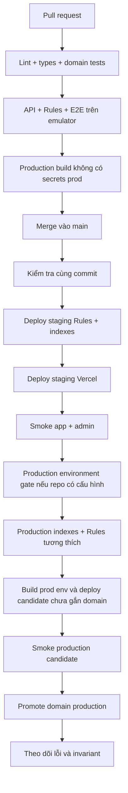

# ShareBill — CI/CD, triển khai và vận hành

**24/11/2026:** đã triển khai giao diện responsive và cập nhật PWA tự động tại SHA `a35e0bda14b9636ca0e5aac620c7cb8b9472f2fb` lên domain web hiện tại. Worker mới chờ các tab sẵn sàng rồi tự kích hoạt/tải lại, bảo vệ bản nhập và lệnh ghi; phiên bản cũ vẫn hỗ trợ nút xác nhận cập nhật một lần để chuyển tiếp. Đã đạt 19 hành trình local, 4 tình huống đổi worker, và kiểm release/worker/API/CORS/mobile/offline trên domain thật. [Báo cáo phát hành](reports/2026-11-24-responsive-auto-update-release.json).

**20/11/2026:** đã đưa QR và ảnh chuyển khoản lên hai domain staging tại SHA `11b870a551ba700d0600d093f2ab16c5b5fd898b`. Kho `sharebill-private-images` dùng Vercel Blob private/Hobby, vùng Singapore. Đã kiểm upload/finalize/claim/xem ảnh thật, CORS trình duyệt, chặn pending trùng, xác nhận cập nhật số dư và mở thẻ QR trong tab người dùng. Cloudflare R2 chưa được kích hoạt. Xem [báo cáo phát hành QR](reports/2026-11-20-qr-payments-release.json); ghi chú bucket Firebase chưa gắn bên dưới là trạng thái cũ của adapter Cloud Storage.

Tài liệu thiết lập staging và kế hoạch đưa ShareBill vào vận hành.

Ngày 19/11/2026 đã deploy FE/API cùng SHA `5256b3f` sau CI, kiểm trên domain staging và lưu [báo cáo S18](STAGING_SMOKE.md). Auth Email/Password, luồng tiền và đủ 18 composite index đạt cloud. Google quản trị, bucket ảnh và thiết bị thật còn cổng riêng. Các project hiện deploy bằng CLI từ monorepo, chưa tự deploy theo Git push.

Repo tách Web/PWA Next.js ở `fe/` và API Fastify ở `be/`. Hai thư mục có cấu hình Vercel riêng. GitHub Actions kiểm tra các gói trong cùng monorepo.

## Môi trường staging hiện tại

- Web/PWA ở [sharebill-nghiep22.vercel.app](https://sharebill-nghiep22.vercel.app/), thuộc tài khoản Vercel Hobby. Trang chính dùng API thật; bản xem thử đã được gỡ, `/demo` chuyển về ứng dụng chính.
- API ở [sharebill-api-staging.vercel.app](https://sharebill-api-staging.vercel.app/health), có tài liệu tương tác tại [/docs/](https://sharebill-api-staging.vercel.app/docs/).
- Firebase project `sharebill-staging` dùng Spark, bật đăng nhập Email/Password và Firestore Standard tại `asia-southeast1` (Singapore). Rules và indexes lấy từ `be/`.
- Runtime API dùng service account `sharebill-api@sharebill-staging.iam.gserviceaccount.com` với `roles/datastore.user` và `roles/firebaseauth.admin`. Thông tin xác thực nằm trong secrets của Vercel.
- GitHub Actions kiểm tra frontend và backend trên PR. S10 đã có adapter Cloud Storage và kiểm local/Emulator; staging chưa gắn bucket ảnh. Lựa chọn lưu trữ cloud phải giữ ràng buộc môi trường miễn phí hiện tại.

Môi trường này triển khai theo yêu cầu chỉ dùng gói miễn phí của người dùng, với Vercel Hobby và Firebase Spark.

## Staging đầu tiên

1. Trong Vercel, import cùng repo GitHub hai lần, với Root Directory lần lượt là `fe` và `be`. Bật quyền truy cập các file ngoài Root Directory để hai project đọc được `pnpm-lock.yaml` và `pnpm-workspace.yaml` ở gốc repo. Chọn Node.js 24.x. [Vercel monorepo](https://vercel.com/docs/monorepos).
2. Với `fe`, chạy build theo `fe/vercel.json` và phục vụ thư mục `out`. Kiểm tra trang chủ, `/release.json`, `/manifest.webmanifest` và `/sw.js` qua HTTPS. Cấu hình public lúc build phải trỏ đúng API/Firebase staging.
3. Tạo hoặc chọn một Firebase project dành cho staging. Bật đăng nhập Email/Password, tạo Firestore và áp dụng Rules/indexes từ `be/firebase.json`. [Firebase Admin SDK](https://firebase.google.com/docs/admin/setup).
4. Với `be`, dùng cấu hình `be/vercel.json` và đầu vào serverless `be/api/index.ts`. Các đường dẫn HTTP được chuyển vào Fastify. Đặt `APP_ORIGIN` bằng origin của Web/PWA, cấu hình `FIREBASE_PROJECT_ID`, `FIREBASE_WEB_API_KEY`, `CURSOR_SIGNING_SECRET` riêng ít nhất 32 ký tự và thông tin xác thực runtime `FIREBASE_CLIENT_EMAIL`, `FIREBASE_PRIVATE_KEY` trong Vercel. Cấu hình emulator chỉ dùng ở local và CI.
5. Kiểm tra API `/health` và `/docs/`, sau đó dùng tài khoản thử để đăng ký, đăng nhập, tạo chuyến và thêm khoản chi. Backend ảnh S10 mới kiểm local/Emulator; lựa chọn bucket/signing trên cloud thuộc cổng S18. Adapter mặc định là Cloud Storage for Firebase; R2 là phương án thay adapter nếu cần sau khi chốt yêu cầu môi trường. Xem [cấu hình và cổng smoke ảnh](RECEIPTS.md).

## 1. Kiến trúc triển khai

Vercel host Web/PWA Next.js và API Node.js/Fastify. Firebase cung cấp Auth và Firestore. S10 có backend ảnh với adapter Cloud Storage mặc định, chưa triển khai bucket thật; lựa chọn cloud tiếp tục tuân thủ ràng buộc staging miễn phí. GitHub Actions chạy kiểm tra khi mở PR hoặc cập nhật `main`, còn Vercel có thể nhận thay đổi qua tích hợp Git.

Quy trình dưới đây mô tả bước mở rộng khi dùng Actions để điều phối staging, smoke test và đưa bản đã kiểm tra lên production. Khi chuyển sang deploy bằng CLI trong Actions, tắt deployment tự động trùng lặp từ Git integration.



Hướng dẫn nền tảng cho build/deploy CLI: [Vercel và GitHub Actions](https://vercel.com/kb/guide/how-can-i-use-github-actions-with-vercel). Trình tự release cụ thể dưới đây là quyết định của dự án.

## 2. Môi trường và cách ly dữ liệu

| Môi trường | Web/API | Firebase | Dữ liệu | Quyền cloud |
| --- | --- | --- | --- | --- |
| local | localhost | Emulator `demo-sharebill` | Fixture có thể reset | Không cần key prod |
| CI | Runner ephemeral | Emulator `demo-sharebill-ci` | Fixture riêng mỗi run | Không có secret cloud |
| PR preview tùy chọn | Vercel staging project Preview | Firebase staging | Synthetic, namespace test | Chỉ trusted branch |
| staging | Vercel project `sharebill-staging` | Project `sharebill-staging` | Synthetic/dữ liệu thử | Credential staging |
| production | Vercel project `sharebill-production` | Project `sharebill-production` | Người dùng thật | Credential production riêng |

- Hai Vercel project và hai Firebase project tối thiểu cho staging/prod; không chỉ đổi prefix collection.
- Chọn Firestore/Storage region gần nhóm sử dụng và API region tương thích theo gói hiện có; xác nhận trước khi tạo vì đổi location về sau khó.
- Cấu hình website/app/API trong cùng một environment phải trỏ cùng Firebase project/bucket.
- Không bật emulator flag ở staging/prod; startup fail rõ nếu phát hiện cấu hình lẫn.
- Preview không được dùng Firebase prod, kể cả khi URL được bảo vệ.
- Đăng ký/đăng nhập Email/Password thật phải được kiểm trên domain staging ổn định và production domain. Nếu bật Google OAuth cho admin, kiểm thêm trên canonical domain; không thêm wildcard mọi PR hostname vào Authorized Domains.
- Candidate deployment dùng production config; trước promote kiểm token/API bằng test account, sau promote kiểm đăng nhập thật trên canonical domain. Không coi auth đã test chỉ vì trang login tải được.
- Protection preview phụ thuộc gói và cấu hình. [Vercel Deployment Protection](https://vercel.com/docs/deployment-protection).

## 3. Bootstrap từ thư mục trống

### 3.1. Máy phát triển

1. Chọn Node.js LTS được Next.js và Vercel hỗ trợ; đề xuất Node 24 LTS cho baseline, pin patch ở `.node-version` sau khi xác nhận trên platform.
2. Cài pnpm phiên bản cố định; khai báo `packageManager` trong package.json.
3. Khởi tạo Next.js TypeScript/App Router/Tailwind, bật strict và ESLint.
4. Cài Firebase SDK/Admin SDK, form/query/schema và test tools theo nhu cầu từng chặng.
5. Cài Java LTS phù hợp Emulator Suite, đề xuất Java21; kiểm yêu cầu bản `firebase-tools` đã pin.
6. Tạo `.env.example` chỉ chứa placeholder; `.env.local`, `.vercel`, key JSON và emulator export private nằm trong `.gitignore`.
7. Khởi tạo Auth/Firestore/Storage emulators, Rules và indexes trong repo.
8. Tạo seed fixture và guard project bắt đầu bằng `demo-`; không cho seed/reset chạy trên prod.

Node production nên dùng LTS; kiểm lịch phát hành khi nâng version. [Node.js releases](https://nodejs.org/en/about/previous-releases). Emulator workflow xem [Firebase Emulator Suite](https://firebase.google.com/docs/emulator-suite/connect_and_prototype).

### 3.2. Commands dự kiến

Các script này cần được tạo trong implementation; tài liệu không giả định đang có package.json.

```text
pnpm dev                    # App + admin + API local
pnpm emulators              # Auth + Firestore + Storage local
pnpm seed:emulator           # Fixture, chỉ demo project
pnpm lint
pnpm typecheck
pnpm test:unit
pnpm test:rules
pnpm test:integration
pnpm test:e2e
pnpm build
pnpm start
pnpm smoke --base-url=...
pnpm jobs:cleanup --project=... --dry-run
pnpm jobs:reconcile --project=... --trip-id=... --dry-run
```

Integration/Rules/E2E scripts được bao bằng `firebase emulators:exec` để emulator được start/stop đúng lifecycle. Nếu chạy chung một emulator cho bộ test, seed namespace riêng và reset giữa suite để không xung đột.

### 3.3. Tạo cloud staging trước

- Tạo Firebase staging, bật Email/Password Auth, Firestore, bucket private và billing cần thiết cho Storage. Chỉ bật Google provider nếu triển khai admin Google OAuth.
- Deploy deny-by-default Rules trước khi public app; không dùng test mode.
- Tạo service account runtime có quyền tối thiểu cho Auth/Firestore/Storage và khả năng ký URL; tách deploy identity nếu khả thi.
- Tạo Vercel staging project, thiết lập Node/runtime/build/install commands, env config, canonical staging domain.
- Thêm đúng staging domain vào Firebase Auth Authorized Domains; cấu hình OAuth consent/provider nếu bật đăng nhập Google cho admin.
- Bootstrap platform admin staging bằng UID đã xác minh; không seed admin production từ email fixture.
- Chạy đầy đủ release rehearsal trên staging rồi lặp cấu hình production riêng biệt.

## 4. Secrets và quyền pipeline

| Nhóm | Nơi lưu | Ví dụ |
| --- | --- | --- |
| Firebase web config | Vercel build env, không phải secret bảo mật | NEXT_PUBLIC_FIREBASE_* |
| Runtime API secrets | Vercel environment tương ứng | private key, client email, cursor secret |
| Vercel deployment auth | GitHub environment secrets | VERCEL_TOKEN, VERCEL_ORG_ID, VERCEL_PROJECT_ID |
| Firebase deploy auth | GitHub environment, ưu tiên OIDC/WIF | Credential có quyền deploy Rules/indexes |
| Job runtime auth | Credential của trusted job | Cleanup/reconcile/Auth sync |
| Synthetic smoke auth | Staging/prod riêng, quyền hạn hẹp | Tài khoản kiểm thử, không hardcode token |

Không in env ra console, không upload `.env*`, `.vercel/.env*`, service key hoặc auth state Playwright vào artifacts. Không cache `.vercel/output` chứa cấu hình runtime private lên nơi public. Trace/screenshot test chỉ dùng synthetic data và retention ngắn.

GitHub token mặc định `contents: read`; job nào cần thêm quyền phải khai báo riêng. Pin GitHub Actions bằng full commit SHA từ release được review, pin CLI trong lockfile; không `npm install -g ...@latest` mỗi lần deploy. [GitHub secure use](https://docs.github.com/en/actions/reference/security/secure-use).

Pull request từ fork chạy checks không secrets. Không dùng `pull_request_target` rồi checkout/chạy code PR có quyền secret. Trusted preview chỉ từ branch/revision đã được quy trình repository tin cậy; không tải arbitrary artifact của PR rồi chạy trong job production.

## 5. CI bắt buộc trên mỗi PR

| Job | Nội dung | Fail khi |
| --- | --- | --- |
| static | Frozen install, lint, typecheck | Code/config sai |
| domain | Money/splits/deltas/suggestions, property tests | Bất biến tiền sai |
| emulator | Rules + API auth + transactions + idempotency | Người ngoài đọc/ghi được hoặc số dư lệch |
| e2e | Tạo chuyến, expense, trả nợ, admin deny/allow | Luồng cốt lõi không hoàn tất |
| build | Build Next.js với cấu hình demo không bí mật | Import server vào client hoặc build lỗi |
| dependency/security | Kiểm secret và dependency theo policy repo | Secret lộ hoặc vulnerability chặn release |

Không ép mọi PR chạy load test nặng. Full browser/regression suite theo main/release; chạy targeted tests khi đổi domain/auth/storage/admin.

### 5.1. Skeleton workflow

Mẫu dưới đây thể hiện job gating. `PINNED_*_SHA` là placeholder phải thay bằng full SHA đã xác minh; chưa phải YAML sẵn chạy. Các scripts/env vars tương ứng phải được implementation trước.

```yaml
name: ci
on:
  pull_request:
  push:
    branches: [main]
permissions:
  contents: read
concurrency:
  group: ci-${{ github.ref }}
  cancel-in-progress: true
jobs:
  verify:
    runs-on: ubuntu-latest
    timeout-minutes: 25
    steps:
      - uses: actions/checkout@PINNED_CHECKOUT_SHA
        with:
          persist-credentials: false
      - uses: pnpm/action-setup@PINNED_PNPM_SETUP_SHA
      - uses: actions/setup-node@PINNED_SETUP_NODE_SHA
        with:
          node-version-file: .node-version
          cache: pnpm
      - uses: actions/setup-java@PINNED_SETUP_JAVA_SHA
        with:
          distribution: temurin
          java-version: '21'
      - run: pnpm install --frozen-lockfile
      - run: pnpm lint
      - run: pnpm typecheck
      - run: pnpm test:unit
      - run: pnpm test:ci:emulator
      - run: pnpm build
        env:
          APP_ENV: test
          NEXT_PUBLIC_FIREBASE_PROJECT_ID: demo-sharebill-ci
```

Script build cung cấp đủ web config placeholder và server validation phù hợp test, không lấy production secret để “sửa build”. E2E cài Playwright browsers/deps theo version lockfile; có webServer production build riêng nếu suite cần kiểm artifact thật.

## 6. CD staging

Chạy trên push main sau tất cả checks cùng SHA đạt:

1. Lấy source đúng SHA, install frozen và cấu hình environment staging.
2. Deploy indexes mới trước, đợi trạng thái Ready; nếu chưa Ready, dừng release dùng query mới.
3. Deploy Firestore/Storage Rules tương thích đồng thời app cũ/mới.
4. Pull Vercel env đúng staging project.
5. `vercel build --prod` với config production environment của **project staging**.
6. `vercel deploy --prebuilt --prod` vào canonical staging domain.
7. Chạy smoke app/admin bằng synthetic accounts.
8. Ghi release record: SHA, deployment URL/ID, Firebase project, Rules hash, index revision, test run, người điều phối nếu có.

Không chạy database reset/seed phá dữ liệu staging dùng chung trên mỗi deploy. Test tạo trip namespace riêng, archive sau khi cân bằng; cleanup synthetic data bằng job riêng có allowlist.

## 7. CD production

### 7.1. Điều kiện

- Cùng SHA đã qua staging smoke, không có blocking bug về tiền/quyền/dữ liệu.
- Backup gần nhất hợp lệ, schema/index changes có kế hoạch rollback tương thích.
- Production environment secrets/project ID đúng; actor triển khai có quyền đã cấp bởi repository.
- Nếu repo cấu hình required reviewers cho environment thì workflow chờ gate đó. Đây là tùy chọn vận hành repository, không một yêu cầu xác nhận mới khi chỉ đang viết tài liệu.

### 7.2. Deploy candidate rồi promote

```text
vercel pull --yes --environment=production
vercel build --prod
vercel deploy --prebuilt --prod --skip-domain
smoke test candidate URL bằng synthetic account
vercel promote <candidate-deployment-url>
smoke canonical production domain + Email/Password auth + admin route guard
```

CLI lấy auth từ secret context, không đưa secret vào lệnh được echo. Commands trên là mô tả, không chạy trong bước tạo tài liệu.

`--skip-domain` tạo production candidate chưa tự gắn domain; promote sau kiểm tra. [Vercel deploy](https://vercel.com/docs/cli/deploy), [Vercel promote](https://vercel.com/docs/cli/promote).

**Không promote nguyên preview/staging artifact chứa Firebase staging sang prod.** `NEXT_PUBLIC_*` bị đóng vào web bundle lúc build; phải build production config riêng từ cùng SHA. Chứng minh project client/server cùng prod qua config assertions và smoke. Candidate production chỉ synthetic writes được gắn namespace, không migration ngầm vào dữ liệu user khi khởi động.

### 7.3. Smoke tối thiểu

- `/health` trả đúng SHA, page app/admin tải được.
- Không token → API private401; user thường → admin403; admin thật của smoke → admin `/me`200.
- Synthetic user bootstrap, tạo chuyến và expense nhỏ, GET balance đúng; retry cùng key không thêm expense thứ hai.
- Void expense, balances trở0, archive trip test; không xóa hard ledger thật.
- Private receipt path không đọc trực tiếp; signed URL test nếu Storage thay đổi trong release.
- Trip suspended chặn financial writes; mở lại normal không đổi ledgerVersion.
- Canonical domain login Google trên thiết bị/luồng đã hỗ trợ.

Smoke financial writes chỉ với tài khoản/trip synthetic được định danh rõ. Có runId, không động vào trip user ngẫu nhiên. Admin smoke không khóa user thật để thử chức năng.

### 7.4. Serialize release

Production deploy concurrency group cố định, `cancel-in-progress: false`. Release mới đợi release trước xong; không cancel giữa deploy Rules và promote. Không cho commit cũ chạy chậm promote đè commit mới; kiểm release queue/SHA trước promote.

## 8. Schema/Rules migrations và rollback

### 8.1. Expand → migrate → contract

1. Bổ sung field/index tương thích, đọc được tài liệu cũ bằng default rõ ràng.
2. Deploy server đọc cả cũ/mới, client chỉ ghi format mới thông qua server.
3. Backfill job có dry-run, batch nhỏ, checkpoint, version checks và report.
4. Theo dõi đủ thời gian bao gồm PWA client cũ đang mở.
5. Chỉ bỏ field/Rules cũ khi client cũ không còn được hỗ trợ; có version-upgrade banner nếu bắt buộc.

Không deploy Rules khóa client cũ trước khi client mới sẵn sàng. Financial algorithm changes cần test fixture cũ và không tự rewrite shares lịch sử.

### 8.2. Rollback ứng dụng

- Ghi deployment ID gần nhất tốt và commit trong release record.
- Khi lỗi, dừng promote/release tiếp theo, rollback domain về deployment phù hợp bằng CLI/dashboard theo quyền gói.
- `vercel rollback <known-good-deployment>` là lệnh tham khảo; xác nhận project/environment và cách dùng hiện tại trước thực hiện. [Vercel rollback](https://vercel.com/docs/cli/rollback).
- Re-run smoke, theo dõi errors/invariant, ghi incident timeline.
- Rules/index rollback tách biệt, chỉ về version còn tương thích dữ liệu hiện tại. Không xóa index đang dùng chỉ để “giống bản cũ”.

Rollback app không đảo các expense/settlement đã commit. Nếu bug làm sai dữ liệu: khóa ghi phạm vi ảnh hưởng, backup, reconcile dry-run, xác định repair dựa audit; không restore toàn database để chữa một khoản mà làm mất giao dịch người khác.

## 9. Jobs và lịch vận hành

| Job | Tần suất thiết kế | Cơ chế P0 | Bảo vệ |
| --- | --- | --- | --- |
| Receipt cleanup | Hàng ngày | Trusted GitHub scheduled workflow chạy Node script | Checkpoint, status lock, generation precondition |
| Balance reconciliation | Hàng ngày, ưu tiên trip vừa thay đổi | Node script paging, dry-run/report mặc định | So ledgerVersion đầu/cuối, không tự repair |
| Auth moderation sync | Thử inline có giới hạn sau command; retry định kỳ | Worker Node có lease + trusted workflow 5 phút | Không fire-and-forget trong function |
| Backup | Hàng ngày | Managed backup nếu cấu hình hỗ trợ, hoặc managed export có kiểm chứng | Identity riêng, retention và alert |
| Dependency updates | Hàng tuần | PR update lockfile + CI | Không auto deploy major upgrade |

GitHub schedule có thể trễ, không phải hàng đợi realtime/SLA. Inline Auth worker chỉ chạy trong request được await và time budget; nếu pending lâu, hiển thị UI và alert. Khi cần vận hành liên tục hơn, chuyển sang durable queue/worker hoặc Cloud Scheduler có xác thực; không tăng tần suất browser polling để thay worker.

Workflow schedule của sản phẩm là cấu hình repo/hạ tầng ở bước triển khai, không phải tạo automation trong ứng dụng Codex tại bước lập kế hoạch này.

## 10. Backup và restore

- Mục tiêu khởi đầu: RPO24h, RTO4h, phải diễn tập và đo; không coi là bảo đảm mặc định.
- Chọn managed scheduled backups nếu khả dụng theo region/edition, hoặc managed export vào bucket backup riêng với billing/IAM phù hợp. Kiểm tính nhất quán snapshot của chế độ chọn; export thường không nên được coi là bản chụp cùng một thời điểm nếu không cấu hình được cơ chế snapshot/PITR phù hợp.
- Backup toàn bộ các collection ledger + audit + operations + membership/links. Thiếu operation keys có thể làm retry sau restore tạo trùng.
- Ảnh Storage có retention/versioning hoặc bản sao phù hợp, backup metadata alone không phục hồi bytes.
- Backup auth identities và admin grants có quy trình riêng phù hợp Firebase; export Firestore không bao gồm Firebase Authentication users.
- Retention đề xuất7 bản ngày và4 bản tuần; xác minh tính năng/chi phí thực tế trước bật.
- Không đưa backup private vào repo/artifacts public hoặc database staging mở rộng quyền.
- Hàng tháng restore vào project cô lập, chạy reconciliation và kiểm sample receipt, membership, admin restrictions, operation replay.
- Restore production là thay đổi tác động dữ liệu, chỉ theo runbook đã xét phạm vi; tạm khóa ghi, kiểm generation/version, xác nhận điểm khôi phục và replay sau backup nếu có.

Tài liệu nền tảng: [Firestore export/import](https://firebase.google.com/docs/firestore/manage-data/export-import). Chi phí backup, restore và PITR phải kiểm theo [Firestore quotas](https://firebase.google.com/docs/firestore/quotas) và pricing lúc bật.

## 11. Logs, metrics và cảnh báo

Structured logs: `requestId, actorUidHash, tripId, routeTemplate, operationKeyHash, outcome, durationMs, releaseSha, errorCode`. Không log bearer token, raw invite, signed URL, note, ticket message hoặc toàn body.

| Chỉ số | Tín hiệu cần xử lý |
| --- | --- |
| API error5xx/p95 | Tăng sau release hoặc kéo dài, phân biệt cold start |
| Transaction conflicts/retries | Trip root contention, retry vượt ngưỡng |
| Balance invariant mismatch | Alert ngay, khóa ghi phạm vi phù hợp và điều tra |
| Upload/finalize failure | Ảnh hỏng, quota, credential signing hoặc lease stuck |
| Auth sync backlog | Disabled/enabled chưa khớp, job lỗi |
| Backup/cleanup/reconcile age | Job không chạy hoặc không hoàn tất |
| Firebase reads/writes/storage/egress | Tăng bất thường, listener leak, abuse |
| Budget alerts | Ngưỡng50/80/100% ngân sách thỏa thuận |

Budget alert không phải hard spending cap. App limits và rate limits giúp giảm rủi ro, không đảm bảo tổng bill bằng0. Không bật dịch vụ mới chỉ vì có free tier mà không kiểm billing.

Admin system page chỉ đọc summaries an toàn; có link sang observability console theo tài khoản operator. Không hiển thị secrets hay raw logs riêng tư trong UI admin.

## 12. Runbook sự cố ngắn

| Sự cố | Hành động đầu | Kiểm tra tiếp |
| --- | --- | --- |
| Sai số dư | Suspend trip bị ảnh hưởng; giữ read/audit | Reconcile dry-run, operation/audit và release |
| Mất quyền bất thường | Verify project/token/membership/user.status | Admin grant/revoke logs, không mở Rules rộng |
| Storage403 | Intent/membership/expiry, signed policy và signing credential | Bucket IAM/CORS, MIME, size; không bật public bucket |
| Auth email/password lỗi | Provider, project/API key, domain, cấu hình browser | Staging đăng ký/đăng nhập thật, JWT và refresh |
| Credential lộ | Revoke/rotate ngay, redeploy config | Audit access, log/artifact exposure |
| Function timeout | Tra operation key trước retry | DB commit outcome, cold start, dependency latency |
| Auth job lỗi | Giữ user app status an toàn, retry current desired version | Auth permission, worker lease, stale jobs |
| CI fail | Chặn release, sửa nguyên nhân | Không skip money/auth tests để deploy nhanh |

## 13. Checklist release lần đầu

- [ ] Local/CI dùng emulator và demo project, có seed/reset guard.
- [ ] Staging/prod tách Vercel/Firebase/credentials và domain.
- [ ] Rules deny mặc định, client ledger writes bị chặn.
- [ ] Indexes Ready, migrations tương thích bản cũ/mới.
- [ ] Admin được bootstrap đúng UID, user thường không vào admin.
- [ ] Secrets không có trong Git/web bundle/test artifacts.
- [ ] Money/concurrency/idempotency/auth/storage/admin tests đạt.
- [ ] Usability với người mới đạt, Android/iOS luồng chính chạy thật.
- [ ] Backup/restore rehearsal và reconciliation đạt trên staging.
- [ ] Candidate production smoke đạt trước promote.
- [ ] Email/Password auth canonical domain và private receipt smoke sau promote đạt.
- [ ] Có release record, deployment rollback target và người vận hành biết runbook.
