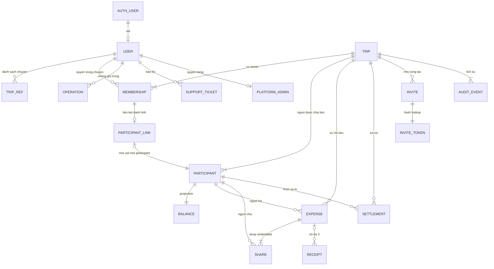
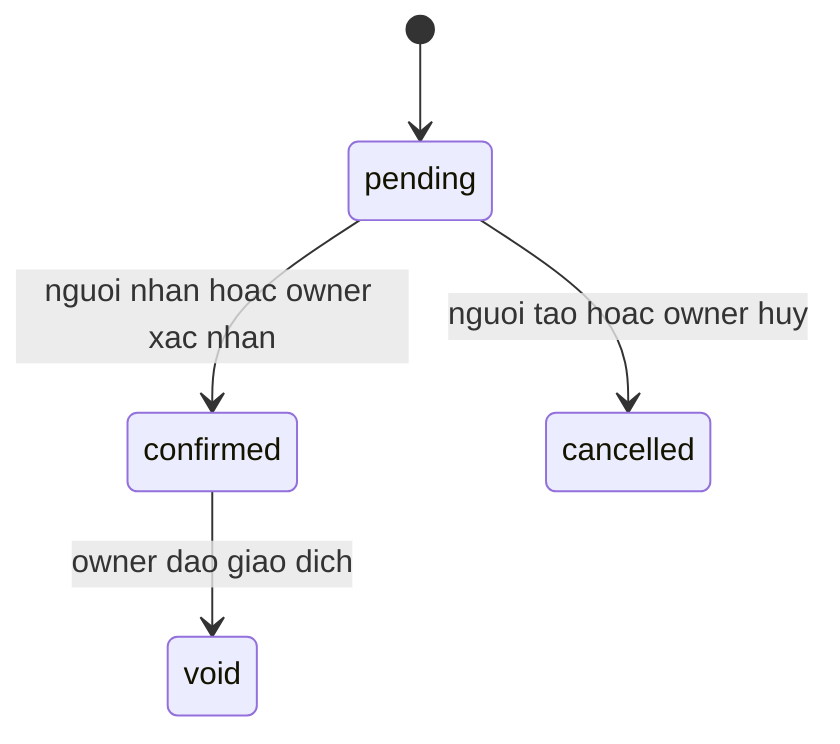

# ShareBill — Thiết kế và kế hoạch hoàn thiện cơ sở dữ liệu

Phiên bản thiết kế 1.0 · 16/11/2026 · Backend Node.js/Fastify, Firebase Authentication, Cloud Firestore Standard edition.

Tài liệu này là đầu mối thiết kế CSDL cho app chia tiền và website quản trị React/Node.js. Bao gồm quan hệ dữ liệu, từng collection, ràng buộc, index, transaction, dữ liệu mẫu, migration và nghiệm thu. Quy tắc sản phẩm ở [PRODUCT_PLAN.md](PRODUCT_PLAN.md); hợp đồng API ở [BACKEND.md](BACKEND.md); quyền quản trị ở [ADMIN_WEB.md](ADMIN_WEB.md).

**Phân biệt thiết kế và triển khai:** các schema bên dưới là trạng thái đích. Code hiện mới ghi một phần trường của các collection lõi; việc thêm tài liệu/index không tự backfill dữ liệu hay tạo các API còn thiếu. Mục 2 ghi trạng thái thực tế; mục 11 là backlog thực hiện. Chưa tạo Firebase cloud project và chưa triển khai index lên cloud.

## 1. Kiến trúc lưu trữ đã chọn

| Thành phần | Lưu ở đâu | Trách nhiệm |
| --- | --- | --- |
| Email, mật khẩu, danh tính và phiên | Firebase Authentication | Quản lý mật khẩu, cấp ID token JWT và refresh token |
| Hồ sơ app, chuyến, sổ tiền, quyền | Cloud Firestore | Dữ liệu nghiệp vụ và transaction |
| Bytes ảnh hóa đơn | Cloud Storage for Firebase | Object private; Firestore lưu metadata và generation |
| Bản nháp, cache tùy chọn | IndexedDB trên thiết bị | Hỗ trợ offline; không là nguồn số dư chính thức |
| Secrets dịch vụ | Secret store của host | Private key, credentials; không đặt trong document hoặc FE |

Firestore là phương án triển khai hiện tại. Không cần vận hành thêm SQLite song song. Nếu chuyển sang SQLite có server lưu trữ bền vững, dùng các quan hệ dưới đây để xây migration SQL riêng theo [phương án thay thế](BACKEND.md#12-phương-án-thay-thế-sqlite-có-backend-riêng).

Node API xác minh JWT rồi kiểm quyền trên dữ liệu. Mọi lệnh ghi sổ tiền đi qua API. Client Firestore hiện bị deny toàn bộ trong [firestore.rules](../be/firestore.rules); Admin SDK bỏ qua Rules nên backend phải tự kiểm quyền. Chỉ mở read `signals/current` và own membership nếu có chức năng realtime đã kiểm thử riêng; không mở read toàn chuyến bằng một rule rộng.

## 2. Đối chiếu code hiện tại và thiết kế đích

| Nhóm | Có trong code | Cần hoàn thiện |
| --- | --- | --- |
| Auth/user | Register, login, refresh JWT; bootstrap hồ sơ v1 dùng chung | Migration hồ sơ legacy D13; quyền và lifecycle còn trong backlog |
| Trip | Tạo chuyến v1 với metadata, moderation mặc định, counters và category totals bằng 0 | Cập nhật category totals khi ghi tiền D06; archive/reopen |
| Membership | Owner membership đủ timestamps và tripRef trong cùng transaction | Invite/join/remove/restore; API phân trang |
| Participant | Owner và người thêm sau có participant/balance zero với metadata v1; owner có participantLink | Link/unlink/inactive; migration dữ liệu cũ |
| Expense | Writer v1 lưu `splitInput`, shares, currency/receiptIds và void metadata; reader đọc được legacy `split` | Sửa khoản chi; đồng bộ projection tiền D06; migration legacy D15; receipt lifecycle I01–I07 |
| Settlement | Tạo pending, confirm | Khởi tạo đủ trường nullable; cancel/void; currency; history |
| Balance/signal | Balance owner và người thêm sau có `updatedAt`; signal tạo cùng trip và cập nhật theo revision | Checker/reconciler và repair có kiểm soát; đồng bộ projection tiền D06 |
| Audit/operation | Tạo chuyến có `trip.created` audit và key chống trùng cùng transaction; có một số sự kiện tiền | Audit thống nhất cho mutation khác D08; chuẩn hóa operation D09; endpoint tra outcome |
| Receipt/invite/admin/support/jobs | Đã có mô tả trong tài liệu | Chưa có lifecycle/API/worker hoàn chỉnh |
| Index | Đã bổ sung file cấu hình trong lần cập nhật này | Deploy staging, đợi index ready và chạy query thật; API hiện vẫn chỉ lấy 20/30 bản gần nhất |
| Dữ liệu mẫu | Đã bổ sung `pnpm --dir be db:seed` | Seed chỉ chạy emulator và đi qua API hiện có; không thay migration |

File [firestore.indexes.json](../be/firestore.indexes.json) chứa 16 composite index của thiết kế P0 và 15 field exemption. Có index cho chức năng chưa code để hai phía có hợp đồng rõ ràng; không có nghĩa API tương ứng đã tồn tại.

## 3. Quan hệ và cây dữ liệu



Đây là quan hệ logic, không phải foreign key được Firestore tự kiểm. `SHARE` nằm trong array `expenses.shares`, không tạo collection con. Một người chưa có tài khoản vẫn có participant và balance; chỉ membership gắn UID mới cấp quyền gọi API.

```text
Firebase Authentication: uid, email, password hash, providers, refresh sessions

users/{uid}
  tripRefs/{tripId}
  operations/{idempotencyKey}
trips/{tripId}
  memberships/{uid}
  participantLinks/{uid}
  participants/{participantId}
  expenses/{expenseId}
  settlements/{settlementId}
  balances/{participantId}
  receipts/{receiptId}
  invites/{inviteId}
  auditEvents/{eventId}
  signals/current
inviteTokens/{sha256Token}
supportTickets/{ticketId}
  internalNotes/{noteId}
platformAdmins/{uid}
adminOperations/{uid}/keys/{idempotencyKey}
adminAuditEvents/{eventId}
adminAuthJobs/{jobId}
adminAuthLeases/{uid}
rateLimits/{hashedScopeAndWindow}
maintenanceJobs/{jobId}
schemaMigrations/{migrationId}
```

`adminOperations/{uid}` chỉ làm namespace; document cha không bắt buộc tồn tại. Collection con `keys` phải được đưa riêng vào backup/xóa theo scope. Không dùng root namespace này làm danh sách quản trị viên.

## 4. Quy ước schema và ràng buộc chung

| Quy ước | Thiết kế đích |
| --- | --- |
| Khóa chính | Document ID; entity hiện có dùng UUID v4 do server sinh; UID Auth dùng nguyên UID |
| ID trùng trong document | Nếu có trường `id`/`uid`/`participantId` đại diện chính document, phải khớp document ID |
| ID tham chiếu | Chỉ chứa ID, không nhận path tùy ý từ client; UID không chứa `/` |
| Phiên bản schema | `schemaVersion: 1` trên document do app quản lý; thiếu trường coi là legacy v0 cho migration |
| Phiên bản nghiệp vụ | `version >= 1`; `revision >= 1`; `ledgerVersion >= 0`; không dùng thay `schemaVersion` |
| Trường tùy chọn | Field trong schema tồn tại; dùng `null` cho giá trị chưa có, tránh `undefined`; không tự điền `null` cho số liệu bắt buộc |
| Timestamp | Firestore Timestamp; server gán lúc ghi, DTO chuyển ISO UTC; không nhận giờ tạo/cập nhật từ client |
| Ngày lịch | Chuỗi `YYYY-MM-DD` là ngày hợp lệ; `startDate <= endDate` nếu có cả hai |
| Timezone | IANA hợp lệ; mặc định `Asia/Ho_Chi_Minh` |
| Tiền | Số nguyên VND; 1..10^12 cho một expense/settlement; share có thể bằng 0 |
| Tổng tiền | Kiểm safe integer trên từng giá trị; cộng tổng/nhân/chia qua `bigint`, không dùng float để chia tiền |
| Chuỗi | Trim tên/note; plain text; độ dài theo bảng; mật khẩu giữ nguyên ký tự, không trim/lowercase |
| Input | Schema allowlist riêng cho HTTP; không ghi thẳng body vào DB; từ chối field lạ |
| Email | Chuẩn hóa trim/lowercase để tìm kiếm, lấy từ Auth của phiên đã xác thực; không là khóa chính nghiệp vụ và không tự coi email đã được xác minh |
| PII/token | Không lưu password, JWT, refresh token, signed URL hoặc raw invite token trong Firestore, audit hay operation |

Firestore không cung cấp foreign key/unique/check constraint như SQL. Các ràng buộc liên document phải nằm trong service transaction; Zod kiểm shape không đủ bảo đảm đúng số dư hoặc đúng quyền.

## 5. Từ điển dữ liệu lõi

Mọi document dưới đây có `schemaVersion: 1` trong thiết kế đích. Các trường thời gian kiểu `Timestamp`; `T?` trong bảng nghĩa là `T | null`, không có nghĩa được phép bỏ field. Giới hạn 50 participants và 50 membership UID all-time, 2.000 expenses và 2.000 settlements all-time áp dụng cho một chuyến, kể cả bản ghi đã hủy.

### 5.1. `users/{uid}` — hồ sơ và khóa tài khoản

| Trường | Kiểu/giới hạn | Giá trị ban đầu và ràng buộc |
| --- | --- | --- |
| displayName | string, 1..80 | Tên từ đăng ký/Auth; không làm unique key |
| email / emailLower | string? <=254 | Lấy từ Auth; emailLower để exact search |
| status | active / disabled | active lúc tạo; bootstrap không reset user bị khóa |
| moderationVersion | integer >=1 | 1; tăng cho lệnh quản trị |
| desiredAuthDisabled | boolean | false; trạng thái đích của Firebase Auth |
| authSyncStatus | synced / pending / failed | synced; theo workflow Auth job |
| disabledReason | string? <=500 | null |
| disabledAt / disabledBy | Timestamp? / UID? | null |
| createdAt / updatedAt | Timestamp | Server gán |

Mật khẩu chỉ do Firebase Auth quản lý. User profile không chứa `role: admin`; quyền platform nằm ở collection riêng. Nếu Auth đã tạo user nhưng Firestore tạm lỗi, lần đăng nhập tiếp theo có thể bootstrap profile. Chưa có hồ sơ không đồng nghĩa là admin hoặc được làm thành viên của chuyến bất kỳ.

### 5.2. `users/{uid}/tripRefs/{tripId}` — danh sách chuyến

| Trường | Kiểu | Quy tắc |
| --- | --- | --- |
| tripId | UUID | Khớp ID; tham chiếu trips |
| status | active / removed | Phản chiếu membership; không phản chiếu trip archived |
| joinedAt / updatedAt | Timestamp | joinedAt giữ lần tham gia đầu tiên; restore cập nhật updatedAt |

Đây là projection phục vụ danh sách. API vẫn đọc membership thật trước khi trả metadata. Không fan-out tên/tổng tiền chuyến vào mọi tripRef. TripRef còn sót không được làm lộ chuyến sau khi đã bị gỡ quyền.

### 5.3. `trips/{tripId}` — chuyến đi và thống kê

| Trường | Kiểu/giới hạn | Mặc định/ràng buộc |
| --- | --- | --- |
| name | string, 1..100 | Bắt buộc |
| destination / note | string? <=150 / string? <=1000 | null |
| startDate / endDate | date? | null; kiểm thứ tự ngày |
| timezone | IANA string | Asia/Ho_Chi_Minh |
| currency / currencyExponent | VND / 0 | Server cố định |
| ownerUid / createdBy | UID | User tạo; ownerUid đổi theo workflow chuyển chủ |
| status | active / archived | active |
| moderationStatus | normal / suspended | normal; độc lập status nghiệp vụ |
| moderationVersion | integer >=1 | 1 |
| moderationReason / moderatedBy / moderatedAt | string? <=500 / UID? / Timestamp? | null |
| inviteEpoch | integer >=1 | 1; tăng khi archive, vô hiệu link cũ |
| version / revision / ledgerVersion | integer | 1 / 1 / 0 |
| participantCount | integer, 1..50 | 1; tổng participants từng tạo, gồm inactive |
| membershipCountAllTime | integer, 1..50 | 1; UID removed/restore không đếm lại |
| expenseCountAllTime / settlementCountAllTime | integer, 0..2000 | 0; không giảm khi void/cancel |
| activeExpenseCount / pendingSettlementCount | integer >=0 | 0; phản chiếu trạng thái hiện tại |
| totalExpenseMinor | safe integer >=0 | Tổng expenses active |
| categoryTotalsMinor | map 6 category -> safe integer >=0 | Mỗi key ban đầu bằng 0; tổng map bằng totalExpenseMinor |
| createdAt / updatedAt / archivedAt | Timestamp / Timestamp / Timestamp? | Server / server / null |

Chỉ một membership active role owner khớp `ownerUid`. Archive chỉ thực hiện khi mọi balance net =0 và không còn settlement pending. Archive không xóa dữ liệu; reopen không hồi sinh invite cũ.

### 5.4. Membership, participant và khóa liên kết

| Collection | Trường đầy đủ ngoài schemaVersion | Ràng buộc |
| --- | --- | --- |
| `memberships/{uid}` | uid; role owner/member; status active/removed; participantId UUID?; version; joinedAt; updatedAt; removedAt Timestamp? | UID khớp ID; participant cùng chuyến; owner luôn active và có participant |
| `participants/{participantId}` | displayName 1..80; linkedUid UID?; status active/inactive; version; hasLedgerReferences boolean; createdBy UID; createdAt; updatedAt | Có balance cùng ID; tên được trùng; không hard delete |
| `participantLinks/{uid}` | uid; participantId UUID; updatedAt | Khóa unique một UID trong chuyến; tồn tại khi đã linked |

`participant.linkedUid`, `participantLinks/{uid}.participantId` và `membership.participantId` phải khớp cả ba chiều. Transaction link/unlink đọc cả link cũ và participant đích. Người nhận invite luôn join với `participantId=null`; không tự nhận danh tính đã có chi phí. Membership removed vẫn giữ khóa danh tính đến khi owner unlink/relink có audit. Người inactive không vào expense mới hoặc sửa phần tiền; vẫn được tính nợ và trả nợ cũ.

`hasLedgerReferences` ban đầu false, chuyển true khi được nhắc tới trong expense/settlement; không tự đổi lại false khi void. Khi tạo chuyến phải tạo owner membership + owner participant + participantLink + zero balance + tripRef trong cùng transaction.

### 5.5. `expenses/{expenseId}` — khoản chi

| Trường | Kiểu/giới hạn | Ràng buộc |
| --- | --- | --- |
| title / note | string 1..120 / string? <=1000 | Note null mặc định |
| amountMinor / currency | integer 1..10^12 / VND | Không nhận currency khác |
| payerParticipantId | UUID | Participant cùng chuyến, active khi tạo/sửa tiền |
| splitMethod | equal / exact | P0 chỉ hai kiểu |
| splitInput | `{participantIds: UUID[]}` hoặc `{shares: Share[]}` | Khớp splitMethod; 1..50 phần, không trùng participant |
| shares | `[{participantId, amountMinor}]` | Server tính; sort theo ID; tổng đúng amountMinor; mỗi phần >=0 |
| occurredOn / category | date / enum | food, transport, stay, tickets, shopping, other |
| receiptIds | UUID[], 0..3 | Không trùng; cùng chuyến và đã được claim đúng expense |
| status / version | active/void / integer >=1 | active / 1 |
| createdBy / updatedBy | UID | Actor đã được xác thực |
| createdAt / updatedAt | Timestamp | Server |
| voidedAt / voidedBy / voidReason | Timestamp? / UID? / string? 1..300 | Null khi active; bắt buộc khi void |

`Share` là dữ liệu embedded, không chứa tên người để tránh phải cập nhật lịch sử khi đổi tên. `shares` là kết quả kế toán được giữ nguyên khi thêm người mới. `splitInput` phục vụ form sửa. Dữ liệu hiện tại có `split`; migration phải copy sang `splitInput` sau kiểm tra, không đổi shares đã ghi.

Chia đều dùng phần dư lớn nhất theo thứ tự participant ID ổn định. Chia exact nhận số tiền nguyên, kiểm tổng bằng `bigint`. Khi sửa, delta số dư = đảo expense cũ + áp expense mới; luôn giữ audit trước/sau. Không hard delete khoản chi đã ghi.

### 5.6. `settlements/{settlementId}` — trả nợ

| Trường | Kiểu/giới hạn | Ràng buộc |
| --- | --- | --- |
| fromParticipantId / toParticipantId | UUID | Cùng chuyến, khác nhau; có thể là participant inactive còn nợ |
| amountMinor / currency | integer 1..10^12 / VND | Không vượt nợ/có tại thời điểm confirm |
| occurredOn / note | date / string? <=1000 | Note null mặc định |
| status | pending / confirmed / cancelled / void | Tạo ở pending |
| basedOnLedgerVersion | integer >=0 | Mốc kiểm số dư của thao tác tạo |
| version | integer >=1 | 1 lúc tạo |
| createdBy / createdAt / updatedAt | UID / Timestamp / Timestamp | Server |
| confirmedBy / confirmedAt | UID? / Timestamp? | Null trước confirm |
| confirmationMode | recipient / owner_on_behalf / null | Hiện rõ nếu owner xác nhận thay |
| cancelledBy / cancelledAt | UID? / Timestamp? | Chỉ chuyển từ pending |
| voidedBy / voidedAt / voidReason | UID? / Timestamp? / string? 1..300 | Chỉ đảo giao dịch đã confirmed, có audit |



Pending/cancelled không ảnh hưởng balances. Confirm chỉ áp một lần; void chỉ đảo một lần. Không sửa from/to/amount sau khi tạo; cancel rồi tạo mới. `confirmed*` vẫn giữ khi void để còn lịch sử. Payload confirm mang ledgerVersion hiện tại, không ghi đè mốc tạo cũ; audit lưu mốc trước/sau.

### 5.7. `balances/{participantId}` và `signals/current`

| Document | Trường | Nguồn tính |
| --- | --- | --- |
| Balance | participantId; paidMinor; owedMinor; sentMinor; receivedMinor; netMinor; updatedAt | Projection từ expenses active + settlements confirmed |
| Signal | revision; ledgerVersion; updatedAt | Cùng giá trị root trip tại transaction commit |

```text
paidMinor     = tổng expense active mà participant ứng tiền
owedMinor     = tổng shares của participant trong expense active
sentMinor     = tổng settlement confirmed mà participant là from
receivedMinor = tổng settlement confirmed mà participant là to
netMinor      = paidMinor - owedMinor + sentMinor - receivedMinor

netMinor > 0: còn được nhận
netMinor < 0: còn phải trả
```

Các component paid/owed/sent/received không âm; mọi số là safe integer. Bắt buộc:

- Mỗi participant có đúng một balance, kể cả inactive và người chưa có tài khoản.
- Tổng net toàn chuyến =0; tổng paid = tổng owed = totalExpenseMinor.
- Tổng sent = tổng received; pending không xuất hiện trong hai tổng này.
- Version của signal khớp root; không đòi một ledgerVersion riêng trên từng balance.
- Không có API cho FE/admin tự PATCH balance. Repair chỉ từ ledger nguồn, theo mục 10.

### 5.8. `auditEvents/{eventId}` — lịch sử nghiệp vụ

| Trường | Kiểu | Nội dung |
| --- | --- | --- |
| eventId / actorUid | UUID / UID | Khóa sự kiện và actor |
| actorDisplayNameSnapshot | string? <=80 | Tên tại thời điểm ghi; null cho lịch sử legacy không biết |
| action | enum do service allowlist | trip.created/updated/archived/reopened, participant.created/linked/unlinked/deactivated, membership.joined/removed/restored, expense.created/updated/voided, settlement.created/confirmed/cancelled/voided, invite.created/revoked, receipt.attached/discarded |
| entityType / entityId | enum / ID | Đối tượng bị tác động |
| before / after | map? | Snapshot allowlist đủ đối soát; expense giữ payer, amount, shares, trạng thái và version |
| reason | string? <=500 | Lý do khi thao tác yêu cầu |
| revision / ledgerVersion | integer | Mốc sau commit |
| operationKey / createdAt | UUID / Timestamp | Liên kết request và thời điểm server |

Audit append-only và commit cùng dữ liệu. Không ghi JWT, raw token, email đầy đủ, receipt URL hoặc nội dung support nhạy cảm vào activity của chuyến. Legacy audit không đủ thông tin trước/sau phải được đánh dấu trong báo cáo migration; không dựng lại một lịch sử chưa từng được lưu.

### 5.9. `users/{uid}/operations/{key}` — chống ghi trùng

| Trường | Kiểu | Ràng buộc |
| --- | --- | --- |
| actorUid / tripId | UID / UUID? | UID khớp namespace; tripId null cho lệnh không thuộc chuyến |
| method / canonicalPath | string | Ví dụ POST và `/api/v1/trips/.../expenses` |
| requestHash | SHA-256 hex 64 ký tự | Hash payload đã validate/canonicalize cùng If-Match |
| state | committed | Không dùng trạng thái pending cho transaction tài chính |
| resourceType / resourceId | enum / ID | Entity đã ghi |
| httpStatus | integer 200..299 | Mã trả thành công gốc |
| responseSnapshot / responseEtag | DTO map / string? | DTO nhỏ; không token/URL có quyền truy cập |
| committedAt | Timestamp | Cùng commit với ledger |

Key UUID v4 unique trong namespace UID. Cùng key cùng command trả kết quả cũ; khác payload, path hoặc method trả 409. Recheck quyền hiện tại trước khi trả snapshot có dữ liệu nhóm. Operation tài chính giữ suốt vòng đời sổ chuyến; không bật TTL 24 giờ. Legacy `path`/`response` phải được đọc tương thích cho đến khi migration hoàn tất để retry cũ không tạo expense thứ hai.

## 6. Ảnh, lời mời và dữ liệu quản trị

### 6.1. `receipts/{receiptId}` và object Storage

| Nhóm trường | Schema đích |
| --- | --- |
| Chủ sở hữu | tripId UUID; uploaderUid UID; schemaVersion 1 |
| Trạng thái | awaiting_upload / processing / ready / attached / discarded / failed |
| Giới hạn upload | declaredContentType image/jpeg hoặc image/png hoặc image/webp; maxBytes=5*1024*1024; expiresAt Timestamp |
| Object gốc | stagingPath string; stagingGeneration string? |
| Object đã xử lý | processedPath string?; processedGeneration string?; bytes integer?; width integer?; height integer? |
| Liên kết | attachedExpenseId UUID?; receipt chỉ thuộc một expense |
| Lease | processingLeaseUntil Timestamp?; processingAttemptId UUID?; processingOperationKey UUID?; processingRequestHash string?; processingBaseVersion integer? |
| Theo dõi | version>=1; createdAt; updatedAt; discardedAt Timestamp?; cleanupAfter Timestamp?; storageDeletedAt Timestamp? |

Các trường cleanup bổ sung vào đặc tả ảnh cũ để worker biết thời điểm được xóa bytes và việc xóa đã hoàn tất. Chúng không tự kích hoạt TTL xóa document receipt.

```text
receipt-staging/{tripId}/{uploaderUid}/{receiptId}/original
receipt-processed/{tripId}/{receiptId}/{processingAttemptId}.jpg
```

Firestore chỉ lưu path/generation, không lưu base64 ảnh, signed URL hoặc policy signature. `generation` là chuỗi để không mất chính xác. Finalize claim lease -> xử lý bytes ngoài transaction -> commit metadata sau khi kiểm lại lease/quyền. Xóa object phải dùng đúng generation và không xóa ảnh attached. Storage và Firestore không commit nguyên tử chung; orphan cần cleanup retry theo [lifecycle ảnh](BACKEND.md#8-ảnh-hóa-đơn-private-upload-và-lifecycle).

### 6.2. `invites/{inviteId}` và `inviteTokens/{sha256Token}`

| Document | Trường ngoài schemaVersion |
| --- | --- |
| Invite | createdBy UID; createdAt Timestamp; expiresAt Timestamp; maxUses integer 1..20; usedCount integer 0..maxUses; revokedAt Timestamp?; version>=1; epoch integer>=1 |
| Token lookup | tripId UUID; inviteId UUID; expiresAt Timestamp; createdAt Timestamp |

Invite mặc định 7 ngày/20 lượt. Sinh token 32 byte ngẫu nhiên, hash SHA-256 làm lookup ID; raw token trả một lần, không ghi audit/operation. Accept kiểm `expiresAt`, `revokedAt`, `usedCount`, `epoch`, trạng thái user/trip và quota membership trong một transaction. Đã là active member không tăng usage; removed member cần owner restore. TTL nếu dùng cho lookup chỉ là dọn rác; request vẫn tự kiểm hạn.

### 6.3. `platformAdmins/{uid}`

Trường: `uid`, `role:'platform_admin'`, `status:'active'|'disabled'`, `version>=1`, `grantedBy` (operator identifier), `grantedAt`, `updatedAt`, `schemaVersion:1`.

Không có public endpoint tự tạo admin; bootstrap bằng operator workflow kiểm UID/project. `platform_admin` không tự trở thành member mọi chuyến và không có quyền sửa tiền tùy ý. Admin API kiểm user active + admin doc active + recent authentication đối với thao tác nhạy cảm.

### 6.4. `supportTickets/{ticketId}` và `internalNotes/{noteId}`

| Document | Trường ngoài schemaVersion |
| --- | --- |
| Ticket | createdBy UID; tripId UUID?; category usability/balance/receipt/account/other; message string 10..2000; status open/in_progress/resolved; version>=1; createdAt; updatedAt; resolvedAt Timestamp? |
| Internal note | createdBy admin UID; message string 1..2000; createdAt Timestamp |

User chỉ đọc ticket của mình qua API; internal notes chỉ cho admin. Gửi tripId cần membership active tại thời điểm tạo. P0 không có attachment support và không có hệ thống email reply. Giới hạn 5 ticket/ngày/UID theo server; không chỉ disable nút gửi trên FE.

### 6.5. `adminAuditEvents/{eventId}` và `adminOperations/{uid}/keys/{key}`

Admin audit gồm `eventId`, `actorUid`, `action` (allowlist), `targetType` (user/trip/ticket/admin/job), `targetId`, `before`, `after`, `reason` (10..500 khi khóa/mở/cấp quyền), `operationKey`, `requestId`, `createdAt`, `schemaVersion`.

Không đưa lý do khóa user hoặc support nội bộ vào activity của nhóm. Admin audit append-only. Admin operation dùng cùng cấu trúc mục 5.9, thêm namespace admin; có thể trả `httpStatus=202` cùng `jobId` cho lệnh đồng bộ Auth. Không lẫn key admin và key app.

### 6.6. `adminAuthJobs/{jobId}` và `adminAuthLeases/{uid}`

| Document | Trường ngoài schemaVersion |
| --- | --- |
| Auth job | uid; desiredDisabled boolean; moderationVersion>=1; status queued/running/succeeded/failed/superseded; availableAt; attempts integer>=0; leaseOwner string?; leaseUntil Timestamp?; lastErrorCode string?; createdBy UID; createdAt; updatedAt; completedAt Timestamp? |
| Per-user lease | uid; jobId; owner string; leaseUntil Timestamp; updatedAt Timestamp |

Đổi trạng thái app, desired Auth state, job và audit/operation trong Firestore transaction. Worker gọi Firebase Auth ngoài transaction, kiểm lại desired state/version trước khi hoàn tất. Khóa user có hiệu lực ngay qua UserDoc; mở user chỉ active sau khi Auth sync thành công. Job cũ không được mở lại một user vừa bị khóa bởi lệnh mới. Retry có backoff/attempt limit; failed được theo dõi trong admin system, không chạy lại vô hạn.

### 6.7. Rate limit, maintenance và migration

| Collection | Trường ngoài schemaVersion | Quy tắc |
| --- | --- | --- |
| rateLimits | scope enum; subjectHash string; windowStart Timestamp; count integer>=0; expiresAt Timestamp | Key hash scope/subject/window; tăng count trong transaction; không lưu IP/email raw |
| maintenanceJobs | type cleanup_receipts/reconcile_balances/backup_check/repair_projection; targetTripId UUID?; status queued/running/succeeded/failed; availableAt; leaseOwner string?; leaseUntil Timestamp?; attempts; cursor map?; expectedLedgerVersion integer?; resultSummary map?; lastErrorCode string?; createdAt; updatedAt; completedAt Timestamp? | Cursor nhỏ, không dump ledger; repair không được tự bật theo lịch |
| schemaMigrations | migrationId string; checksum SHA-256; status running/completed/failed; projectId string; releaseCommit string; cursor map?; processed integer; failed integer; leaseOwner string?; leaseUntil Timestamp?; startedAt; updatedAt; completedAt Timestamp? | Một runner giữ lease; checkpoint sau trang; rerun không áp delta tiền lần hai |

`rateLimits` là lựa chọn lưu counter server cho scope cần dùng chung nhiều instance; quota 5 ticket/ngày phải có record riêng theo UID/ngày. Anti-abuse auth ở ingress/Firebase vẫn cần cấu hình riêng, không xem counter Firestore là cơ chế duy nhất. TTL chỉ dự kiến cho record tạm đã hết hạn; file index hiện chưa bật TTL policy.

## 7. Transaction và toàn vẹn dữ liệu

| Lệnh | Đọc/kiểm tra trước khi ghi | Ghi nguyên tử trong Firestore |
| --- | --- | --- |
| Tạo trip | User active, operation key/hash | Trip, owner membership, owner participant/link/balance, tripRef, signal, audit, operation |
| Thêm participant | User, owner membership, trip writable, quota, operation | Participant, zero balance, counter/revision, signal, audit, operation |
| Link/unlink | User, owner, trip, cả hai participant/link/membership liên quan | Cả ba chiều liên kết, versions, revision/signal, audit, operation |
| Accept invite | User, lookup, invite, trip/epoch/quota, membership cũ, operation | Membership unlinked, tripRef, invite usage, membership counter nếu UID mới, revision/signal, audit, operation |
| Create/edit/void expense | User, member, trip, entity version, participants, receipts nếu có, balances liên quan, operation | Expense, balance deltas, hasLedgerReferences, receipt ownership, counters/category totals, revision/ledgerVersion, signal, audit, operation |
| Tạo pending settlement | User/member, quyền from hoặc owner, trip, cả hai participants/balances, ledgerVersion, quota, operation | Settlement pending, counter/revision/signal, hasLedgerReferences, audit, operation; không đổi tiền |
| Confirm/void settlement | User/member, quyền recipient/owner, entity version/state, ledgerVersion, balances, operation | Settlement, hai balance, counters, revision/ledgerVersion/signal, audit, operation |
| Cancel pending | User/member, creator/owner, entity version/state, operation | Settlement, pending counter, revision/signal, audit, operation; không đổi tiền |
| Archive/reopen | User/owner, trip version, balance net và pending count, operation | Trip status/version/revision/inviteEpoch theo action, signal, audit, operation |
| Suspend/resume trip | User active, admin active, recent auth, trip moderationVersion, operation | Moderation fields, revision/signal, admin audit, admin operation |
| Khóa/mở user | Admin/recent auth, user version, operation | Desired status, moderation version, job, admin audit/operation; Auth xử lý ngoài transaction |

Tất cả reads phải diễn ra trước writes. Callback transaction có thể chạy lại, nên không gửi email, gọi Auth/Storage hoặc sinh tác dụng bên ngoài trong callback. ID sự kiện/resource nên được cấp ổn định trước transaction. Firestore bảo đảm cả tập ghi cùng thành công hoặc cùng thất bại. [Tài liệu transaction chính thức](https://firebase.google.com/docs/firestore/manage-data/transactions).

Tạo/sửa/void tác động tiền tăng `ledgerVersion` đúng một lần; mọi thay đổi nghiệp vụ tăng `revision`. Metadata không đổi tiền chỉ tăng version/revision. Kiểm user active và membership trong chính transaction ghi, không chỉ trước transaction.

## 8. Query, index và phân trang

File thực thi: [be/firestore.indexes.json](../be/firestore.indexes.json); đã nối trong [be/firebase.json](../be/firebase.json). Bảng dưới mô tả 16 composite index theo đúng thứ tự file. Tất cả là COLLECTION scope, trừ ba index receipt dùng COLLECTION_GROUP để worker tìm xuyên chuyến.

| Mã | Collection | Equality filter | Sort chính | Mục đích |
| --- | --- | --- | --- | --- |
| IX01 | tripRefs | status | joinedAt DESC | Chuyến của tôi |
| IX02 | expenses | status | occurredOn DESC | Sổ theo ngày |
| IX03 | expenses | status, category | occurredOn DESC | Lọc danh mục |
| IX04 | expenses | status, payerParticipantId | occurredOn DESC | Lọc người ứng |
| IX05 | settlements | status | createdAt DESC | Pending/confirmed/void |
| IX06 | users | status | createdAt DESC | Admin lọc tài khoản |
| IX07 | trips | status | createdAt DESC | Admin lọc active/archived |
| IX08 | trips | moderationStatus | createdAt DESC | Admin lọc normal/suspended |
| IX09 | supportTickets | createdBy | createdAt DESC | Ticket của tôi |
| IX10 | supportTickets | status | updatedAt DESC | Hàng đợi hỗ trợ |
| IX11 | adminAuditEvents | targetType | createdAt DESC | Lịch sử quản trị trong time window |
| IX12 | adminAuthJobs | status | availableAt ASC | Worker Auth lấy việc |
| IX13 | maintenanceJobs | status | availableAt ASC | Worker maintenance |
| IX14 | receipts (group) | status | expiresAt ASC | Intent hết hạn |
| IX15 | receipts (group) | status | updatedAt ASC | Ready/failed cũ, ứng viên cleanup |
| IX16 | receipts (group) | status | processingLeaseUntil ASC | Lease processing hết hạn |

Query mặc định hiện tại `orderBy(createdAt DESC)` và `orderBy(joinedAt DESC)` không có equality filter dùng single-field index mặc định. Exact lookup UID/tripId dùng document path; exact `emailLower == value` không sort dùng single-field index mặc định. Activity/note list chỉ sort createdAt cũng dùng single-field. Không disable các field này.

**Hợp đồng query:** expense P0 bắt buộc status khi dùng filter category hoặc payer; chỉ nhận một trong category/payer mỗi query. Admin trip chỉ nhận một trong status/moderationStatus. Các tổ hợp chưa có index bị từ chối 422, không fallback quét toàn bộ DB. Time range của admin audit tối đa 31 ngày; page size tối đa 50, tripRef mặc định 20, expense/settlement mặc định 30.

Firestore tự thêm `__name__` làm khóa sort cuối theo chiều trường sort cuối. Query code phải dùng cùng thứ tự `(occurredOn DESC, documentId DESC)` hoặc `(createdAt DESC, documentId DESC)` khi page. Cursor opaque chứa scope/filters/lastSortValue/lastDocumentId và revision thích hợp; server validate phạm vi, không tin path client gửi. Khi thay filter phải bỏ cursor. Không dùng offset. Nếu revision đổi với danh sách tài chính, báo cursor cũ để FE tải lại; tripRef list không được mất nextCursor chỉ vì các root trip bị filter hết ở một trang.

Các field exemption tắt index note, shares, splitInput, categoryTotalsMinor, audit before/after, operation response/snapshot và support message. Những field đó không dùng để query. `response` legacy vẫn được miễn index trong giai đoạn migration. Không thêm mọi tổ hợp filter để “phòng hờ”. [Định dạng index và fieldOverrides](https://firebase.google.com/docs/reference/firestore/indexes).

**Cổng staging:** emulator không kiểm compound index và có khác biệt giới hạn/transaction; pass emulator chưa chứng minh query chạy được trên cloud. Deploy index, chờ READY, chạy từng query thực tế trên staging với credentials server trước khi release. [Giới hạn của emulator](https://firebase.google.com/docs/emulator-suite/connect_firestore).

Khi đã có Firebase staging project và credential deploy, chạy từ root repo; thay ID mẫu bằng ID thực tế trước khi dùng. Đây là hướng dẫn, chưa được thực thi lên cloud trong lần cập nhật này:

```powershell
$taskFirebaseProject = 'ID_FIREBASE_STAGING_THUC_TE'
pnpm --dir be exec firebase deploy --project $taskFirebaseProject --only 'firestore:indexes,firestore:rules'
pnpm --dir be exec firebase firestore:indexes --project $taskFirebaseProject
```

Xem trạng thái xây index trong Firebase Console và chạy query smoke sau khi ready. Credentials deploy cần quyền index/Rules phù hợp; không đưa private key vào Git. Chưa đổi Rules deny-all chỉ để làm query smoke bằng Firebase client.

## 9. Nâng schema dữ liệu cũ

Chưa có lệnh `db:migrate` trong repo. Quy trình dưới đây là yêu cầu để triển khai runner; không chạy tự động khi API boot hoặc khi Vercel build. Không xóa dữ liệu hiện có để làm schema “đúng”.

### 9.1. Các migration cần viết

| ID | Công việc | Điều kiện trước khi đánh dấu hoàn tất |
| --- | --- | --- |
| DBM-001-users | Backfill profile thiếu field từ Firebase Auth; thêm moderation defaults/schemaVersion nếu chưa có | Giữ nguyên disabled/desiredAuthDisabled/version hiện có; user Auth không tồn tại được báo riêng |
| DBM-002-trips | Metadata nullable, timezone/currencyExponent, moderation defaults, inviteEpoch, createdBy/schemaVersion | ownerUid và owner membership hợp lệ; không reset counters tiền |
| DBM-003-links | Backfill participant metadata, membership timestamps, tripRef updatedAt; tạo participantLinks từ các liên kết đã kiểm chứng | Không UID có hai participants; cả ba chiều đúng; conflict vào report, không tự chọn người |
| DBM-004-ledger | Expense split -> splitInput, currency, nullable state fields; settlement currency/state metadata; schemaVersion | Giữ nguyên amount/shares/status/version; invalid share hoặc thiếu participant làm migration fail cho chuyến đó |
| DBM-005-projections | Tính lại categoryTotals/counters, bổ sung balance updatedAt, kiểm signal | So sánh ledger và projection; chỉ repair diff sau backup/maintenance; schemaVersion không che mismatch |
| DBM-006-operations | Chuyển path/response sang canonicalPath/responseSnapshot, suy resourceType/id và actorUid từ path namespace | Key gốc được giữ; không gọi lại command; thiếu thông tin suy ra được thì giữ legacy reader và báo lỗi |
| DBM-007-audit | Chuẩn hóa sự kiện mới, nhận diện legacy events | Không giả lập before/after/actor chưa biết; lưu baseline migration riêng và danh sách giới hạn lịch sử |

### 9.2. Cách runner phải chạy

1. Bắt buộc project/environment rõ ràng; dry-run mặc định. Xác nhận database `(default)`, release commit và backup có thể restore. Seed không được dùng cho bước này.
2. Triển khai reader tương thích v0/v1 và writer chỉ ghi v1 trước. Tạo index và đợi ready. Chưa bỏ legacy `split/path/response` khi reader cũ còn chạy.
3. Runner claim lease `schemaMigrations/{id}`, kiểm checksum; scan bằng cursor document ID, mỗi trang tối đa 100 documents. Không scan vô hạn trong một HTTP request.
4. Với field metadata độc lập, transaction đọc document rồi chỉ thêm field thiếu; so phiên bản trước commit. Với liên kết/counters liên document, xử lý theo chuyến, kiểm root revision/ledgerVersion và membership hiện tại.
5. Không `set` toàn document từ snapshot cũ làm mất field mới. Có bản ghi malformed thì báo document path + mã lỗi, không in note/email/token vào log. Checkpoint cho phép tiếp tục sau crash.
6. Projection repair là tác vụ riêng, khóa ghi chuyến bằng trạng thái maintenance do operator kiểm soát hoặc tạm dừng writer; tính diff, kiểm ledgerVersion không đổi, commit projection/audit/job. Không sửa amount/shares để khớp balance sai.
7. Chạy validation full scope, đối soát tổng tiền và test retry key cũ. Chỉ mark completed khi toàn bộ bản ghi trong scope đạt hoặc đã có ngoại lệ được giải quyết; không bỏ qua lỗi rồi báo thành công.
8. Rollback code vẫn đọc được field mới; ưu tiên roll-forward metadata. Khôi phục từ backup sang database/project riêng để so sánh trước khi thay đường phục vụ; không import đè production trong lúc writer đang chạy.

Không thể tái dựng chính xác thời điểm hay actor của một thay đổi cũ nếu chưa từng lưu. Backfill timestamp dùng thời điểm migration chỉ khi schema cho phép và phải ghi rõ provenance trong báo cáo; không nhận đó là timestamp lịch sử thật. Trường không đủ suy luận phải giữ ngoại lệ/legacy reader đến khi xử lý.

## 10. Đối soát, backup, retention và xóa

### 10.1. Checker và repair

Checker cần kiểm shape/type, FK cùng chuyến, owner unique, liên kết ba chiều, đủ balance, tổng shares, trạng thái settlement, receipt claim, counters/category totals và signal. Tính lại projection từ expenses active + settlements confirmed bằng module domain hiện có. Không cộng amount của expense void hoặc settlement pending vào tổng tiền.

Đối soát một chuyến lấy ledgerVersion trước -> đọc ledger theo trang -> lấy ledgerVersion sau. Nếu đổi thì bỏ kết quả và retry bounded. Chỉ snapshot ledger ổn định mới báo mismatch. Query ledger phân trang tối đa 4.000 financial records/chuyến; không giữ một transaction đọc hàng nghìn documents để làm báo cáo dài. Metadata/counters không liên quan tiền cần kiểm revision riêng.

Checker chỉ đọc và xuất diff tổng hợp. Scheduled reconcile không tự sửa tiền. Repair cần backup, maintenance, dry-run diff, expected ledgerVersion, actor/reason và audit; sau repair chạy checker lại. Tiền nguồn không bao giờ được sửa để làm “hết cảnh báo”.

### 10.2. Retention đề xuất cho P0

Đây là lựa chọn vận hành dự kiến, không phải TTL policy đã bật hay yêu cầu pháp lý.

| Dữ liệu | Chính sách dự kiến |
| --- | --- |
| Trip, participants, ledger, financial audit/operations | Giữ suốt vòng đời chuyến; archive không xóa |
| Invite lookup hết hạn/revoked | Dọn sau khi hết hạn theo worker; accept luôn kiểm hạn trước |
| Rate limit window | Có thể TTL sau khi window hết + khoảng đệm; không dùng TTL làm bộ đếm chính xác |
| Upload intent | Hạn 15 phút; signed policy tối đa 5 phút; hết hạn không có quyền finalize |
| Ready chưa attached | Cleanup sau 24 giờ theo lifecycle; claim discarded trước khi xóa bytes |
| Processing lease | 2 phút; retry bounded, theo workflow tối đa 24 giờ |
| Detached/discarded bytes | Xóa sau 7 ngày; giữ metadata/audit; không xóa attached active/void expense |
| Job summaries/migration report | Đề xuất giữ 90 ngày hoặc lâu hơn khi còn phục vụ đối soát; không TTL audit tài chính |
| Support/admin audit | Chốt retention riêng trước production; chưa tự bật xóa định kỳ |

TTL không xóa subcollections và không bảo đảm xóa ngay khi hết hạn. Xóa document bằng SDK cũng không tự xóa cây con. Bất kỳ workflow xóa chuyến/user nào sau P0 phải liệt kê subcollections, Storage objects, Auth identity và operation tombstones trước khi triển khai. [TTL](https://firebase.google.com/docs/firestore/ttl), [xóa document và subcollections](https://firebase.google.com/docs/firestore/manage-data/delete-data).

### 10.3. Backup và phục hồi

- Mục tiêu thiết kế ban đầu: RPO <=24 giờ, RTO <=4 giờ cho sự cố dữ liệu quy mô P0; chỉ xác nhận đạt sau một buổi restore rehearsal có đo thời gian.
- Thiết lập backup Firestore hằng ngày, đề xuất retention 30 ngày theo khả năng gói đang dùng. Backup/export không thay việc version index/Rules trong Git.
- Nếu export theo collection group, liệt kê đủ collection con; chọn `trips` không tự export mọi subcollection. Export thông thường không mặc nhiên là snapshot đúng thời điểm bắt đầu. [Export/import chính thức](https://firebase.google.com/docs/firestore/manage-data/export-import).
- Firebase Auth identities và Storage bytes cần phương án backup riêng; Firestore export không chứa mật khẩu Auth hay file hóa đơn. Bảo vệ bản export chứa PII bằng IAM riêng.
- Restore vào môi trường cách ly, deploy đúng Rules/indexes và cấu hình retention cần thiết, chạy checker, kiểm ảnh referenced tồn tại đúng generation, kiểm JWT/project và smoke read/write bằng test account.
- Ghi `maintenanceJobs`/báo cáo vận hành: project, bản backup, release, thời điểm, số lượng restored, kết quả kiểm và thời gian phục hồi. Không đưa dữ liệu production vào public CI artifacts.

## 11. Kế hoạch thực hiện để CSDL đạt v1

Các mã DB-01..09 là nhóm công việc lớn. Dùng [các lát cắt nhỏ](slices/README.md) để thực hiện: D01..D22 chuẩn hóa/migration/query, B01..B19 nghiệp vụ, I01..I08 ảnh, A01..A17 quản trị và O06..O14 staging/vận hành. Mỗi lát có dependency và cổng nghiệm thu; bắt đầu D01 thay vì nhận cả nhóm DB-02 trong một thay đổi.

Ước lượng cho một người làm BE, chưa tính thời gian xây toàn bộ FE hay mua/cấu hình cloud. Các collection cho tính năng chưa code chỉ hoàn thành khi có writer/reader/worker và test tương ứng.

| Thứ tự | Hạng mục | Đầu ra phải có | Tham khảo |
| --- | --- | --- | --- |
| DB-01 | Chốt schema và query inventory | Tài liệu này + index config + bảng trạng thái | Đã bổ sung tài liệu/config |
| DB-02 | Schema/factory/repository chung | Types và Zod schema v1; bootstrap user duy nhất; writers hiện tại ghi đủ field; không cast dữ liệu DB thẳng sang domain | 1–2 ngày |
| DB-03 | Hoàn thiện liên kết và metadata | Owner link, timestamps, flags, currency/splitInput/null fields, stats đúng; audit tạo chuyến/thêm người | 1–2 ngày |
| DB-04 | Migration runner và checker | Dry-run, checkpoint/lease, DBM-001..007, báo cáo thiếu/legacy, reconcile read-only | 2–3 ngày |
| DB-05 | Expense edit và settlement lifecycle | Delta cũ/mới, category totals, cancel/void, retry đúng key/version | 2–3 ngày |
| DB-06 | Membership/invite/archive | Unique link, remove/restore, token hash/epoch/quota, all-time counters | 2–3 ngày |
| DB-07 | Receipt metadata và workers | Lease/attempt/generation, attach transaction, cleanup idempotent, orphan tests | 2–3 ngày |
| DB-08 | Admin/support/jobs | Schema, quyền, Auth outbox/lease, audit và queries có pagination | 2–3 ngày |
| DB-09 | Cloud staging và vận hành | Index ready, query smoke thật, concurrency, backup/restore rehearsal, không còn diff projection | 1–2 ngày |

Tổng tham khảo khoảng 13–21 ngày BE sau thiết kế, có thể điều chỉnh theo dữ liệu legacy và cấu hình Storage/Auth. Bắt đầu từ DB-02, sau đó DB-03/04 trước khi mở rộng các luồng tiền. Không đánh dấu “database hoàn thiện” chỉ vì đã tạo đủ collection rỗng.

## 12. Seed và kịch bản kiểm thử

### 12.1. Seed đang chạy được trên emulator

Mở emulator theo [be/README.md](../be/README.md), sau đó từ root repo:

```powershell
pnpm --dir be db:seed
```

Script [seed-database.ts](../be/scripts/seed-database.ts) đọc `be/.env` khi chạy từ `be`, kiểm `FIREBASE_PROJECT_ID=demo-sharebill` và cả hai emulator host đều `127.0.0.1:<port>` trước khi khởi tạo Firebase Admin. Nó gọi API bằng `app.inject`, không cần một API server riêng và không ghi trực tiếp document sai schema writer hiện có.

Mỗi lần chạy tạo một bộ dữ liệu mới, không reset/xóa bộ cũ. Tài khoản emulator có email random được in ở summary và mật khẩu demo công khai `LocalDemo-123!`. Script không in JWT/refresh token. Có một tài khoản ngoài nhóm để thử quyền; Bình/Chi là participants chưa có tài khoản, không giả vờ đã có membership.

| Bước | Dữ liệu | Kết quả |
| --- | --- | --- |
| 1 | Owner An, thêm Bình và Chi | 3 participants, 1 owner membership, 3 balances |
| 2 | An trả khách sạn 900.000đ, chia 3 | Mỗi người chịu 300.000đ |
| 3 | Bình trả ăn uống 300.000đ, chia 3 | Mỗi người chịu thêm 100.000đ |
| 4 | Bình đề nghị trả An 100.000đ, pending | Tiền chưa thay đổi; pendingSettlementCount=1 |

| Participant | paidMinor | owedMinor | sentMinor | receivedMinor | netMinor |
| --- | ---: | ---: | ---: | ---: | ---: |
| An | 900000 | 400000 | 0 | 0 | 500000 |
| Bình | 300000 | 400000 | 0 | 0 | -100000 |
| Chi | 0 | 400000 | 0 | 0 | -400000 |

Root kỳ vọng: totalExpenseMinor=1200000, expenseCountAllTime=2, activeExpenseCount=2, settlementCountAllTime=1, pendingSettlementCount=1, ledgerVersion=2. Category totals đích: stay=900000, food=300000, bốn key khác=0; hiện writer chưa lưu map này nên thuộc DB-03. Seed có assertion tổng tiền, số dư và pending để phát hiện sai luồng đang dùng.

### 12.2. Ma trận nghiệm thu phải bổ sung

| ID | Trường hợp | Điều kiện đạt |
| --- | --- | --- |
| DATA-01 | Tạo chuyến | Đủ 9 loại document của create transaction và schema v1; owner link ba chiều đúng |
| DATA-02 | Số lẻ | 100001đ chia 3 => 33334/33334/33333 theo thứ tự ID; tổng đúng |
| DATA-03 | Exact sai tổng/trùng người | 422; không document nào được commit |
| DATA-04 | Retry cùng key | Một expense và một delta; retry sau confirm/void vẫn không tạo bản mới |
| DATA-05 | Key dùng lại khác command | 409; legacy key sau migration vẫn replay đúng |
| DATA-06 | Edit/void expense | Projection/category totals đúng; audit giữ before/after; counters all-time không giảm |
| DATA-07 | Pending/confirm/cancel/void | Chỉ confirmed đổi tiền; mọi bước duplicate/conflict không áp tiền lần hai |
| DATA-08 | Concurrency | Hai confirm hoặc link tranh cùng participant chỉ một lệnh thắng; request còn lại conflict/replay hợp lệ |
| DATA-09 | Remove/disable cạnh tranh | Không lọt mutation sau khi quyền đã mất; tripRef cũ không cấp quyền |
| DATA-10 | Receipt attach/cleanup cạnh tranh | Không xóa bytes ảnh attached; không attach cùng receipt sang hai expenses |
| DATA-11 | Archive/epoch | Net khác 0 hoặc pending thì chặn; archive rồi reopen không dùng được invite cũ |
| DATA-12 | Reconcile | Phát hiện cố ý làm hỏng projection; ledger đổi giữa scan thì retry, không false mismatch |
| DATA-13 | Migration | Chạy hai lần không đổi tiền, không reset disabled/version, tiếp tục sau crash, invalid rows có report |
| DATA-14 | Rules và API quyền | Firebase client không đọc/ghi private collections; outsider 404; user thường bị chặn namespace admin |
| DATA-15 | Index staging | Từng IX01..IX16 và cursor nhiều trang chạy được trên Firestore thật, không missing-index |
| DATA-16 | Restore | Khôi phục ledger/projection/Auth/ảnh theo scope, chạy checker và đạt mục tiêu RPO/RTO đã đo |

Kiểm thử emulator hiện có mới bao phủ một phần auth và ledger happy path/outsider/retry; chưa xem ma trận này là đã pass. Trạng thái thực thi được theo dõi trong [ROADMAP_TESTING.md](ROADMAP_TESTING.md).

## 13. Điều kiện ký nghiệm thu CSDL v1

- [ ] Mọi writer hiện có ghi đúng schema v1; cùng một kiểu bootstrap user; DB không lưu password/JWT/refresh token.
- [ ] Migration legacy hoàn tất có report; không mất idempotency key hoặc đổi lịch sử tiền; ngoại lệ được xử lý rõ.
- [ ] Foreign key cùng chuyến, unique owner và unique participant link đều được service transaction bảo đảm.
- [ ] Checker không có diff balances/counters/category totals trên fixture và staging scope.
- [ ] Audit và operation cùng commit với mọi mutation; không có TTL xóa key tài chính.
- [ ] Query có pagination và index inventory khớp code; staging index ready và query smoke đạt.
- [ ] Receipt/Auth jobs có lease, retry, version fence; cleanup không xóa nhầm dữ liệu đang dùng.
- [ ] Rules, IAM, secrets và phân quyền admin/member được test; metadata admin không lộ sổ tiền/ảnh.
- [ ] Backup/restore rehearsal hoàn tất, có kết quả và runbook; production không dùng demo credentials.
- [ ] Các collection/tính năng chưa triển khai được ghi đúng trạng thái, không nghiệm thu bằng document rỗng.
