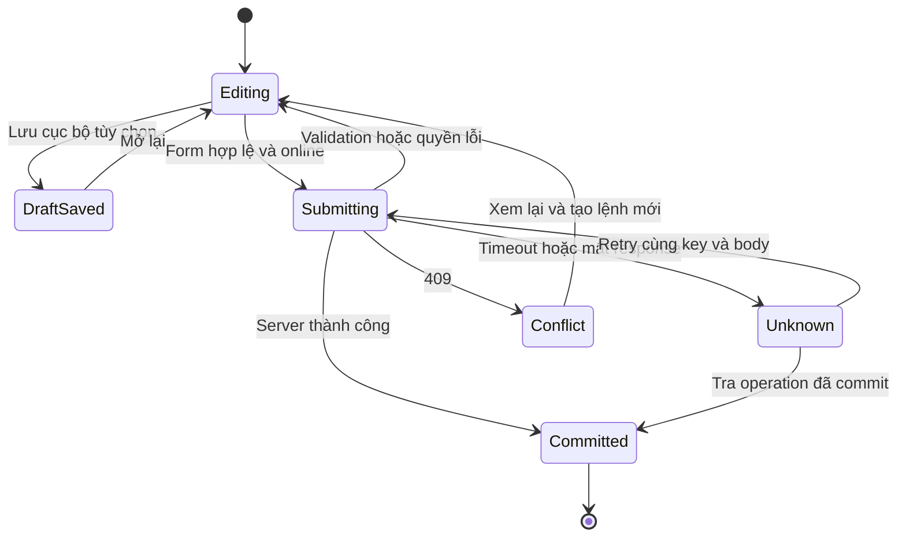

# ShareBill — Đặc tả Frontend

Phiên bản 1.0 · 16/11/2026 · Đọc cùng [Product](PRODUCT_PLAN.md), [Backend](BACKEND.md), [CI/CD](CICD_DEPLOY.md).

**Cập nhật cấu trúc:** frontend React/Next.js và website quản trị sẽ nằm trong `fe/`; API Node.js/Fastify nằm trong `be/`. Các đoạn Route Handler cùng repo ở dưới là phác thảo ban đầu, cần thay bằng API base URL của backend khi triển khai FE. Xem [backend đang chạy](../be/README.md).

Tra nhanh: [Cấu trúc](#2-stack-và-cấu-trúc-dự-án) · [Điều hướng](#3-information-architecture-và-điều-hướng) · [Từng màn hình](#5-đặc-tả-màn-hình) · [State/API](#6-hợp-đồng-state-và-api) · [Offline/PWA](#8-pwa-cache-và-offline) · [Nghiệm thu](#12-definition-of-done-cho-fe).

## 1. Mục tiêu và nguyên tắc

Frontend phải giúp người dùng nhập khoản chi nhanh trên điện thoại, nhìn hiểu số dư và biết thao tác nào đã được server ghi nhận. Bản nháp, request đang xử lý, dữ liệu cũ và dữ liệu đã commit phải phân biệt rõ.

**Yêu cầu ưu tiên của người dùng:** thao tác dễ dàng, dễ hiểu. Luồng thường dùng phải ngắn; chi tiết kỹ thuật trong tài liệu không được biến thành trường nhập hay bước xác nhận thừa trong sản phẩm. Website quản trị React gọi Node.js API có tài liệu riêng tại [ADMIN_WEB.md](ADMIN_WEB.md).

- Ưu tiên tác vụ: tạo chuyến → thêm người → thêm chi tiêu → xem nợ → ghi nhận hoàn tiền.
- Mobile-first, không yêu cầu kéo ngang để làm tác vụ chính.
- Form xem trước cách chia tiền ngay khi nhập; server luôn là nguồn kết quả cuối cùng.
- Không tự sửa tổng tiền, tự bỏ người hoặc tự ghi nhận đã trả khi xử lý lỗi.
- Thao tác nguy cơ làm đổi số dư có phần xác nhận, nêu rõ người và số tiền.
- FE không chứa private key, Admin SDK hoặc logic cấp quyền dựa chỉ vào UI.

## 2. Stack và cấu trúc dự án

| Thành phần | Lựa chọn | Vai trò |
| --- | --- | --- |
| Framework | Next.js stable, App Router | Router, app shell, API cùng repo |
| Ngôn ngữ | TypeScript strict | DTO, form, domain types |
| Giao diện | Tailwind CSS + shadcn/ui chọn lọc | Component dễ chỉnh sửa và kiểm tra accessibility |
| Icon | Lucide hoặc bộ SVG thống nhất | Không phụ thuộc icon font tải ngoài |
| Form | React Hook Form + Zod | Form state và validation |
| Server state | TanStack Query | Fetch, invalidation, mutation status |
| Auth client | Firebase Web SDK modular | Google sign-in, ID token, auth state |
| Realtime | Firestore SDK, listener giới hạn | Signal revision và membership của chính mình |
| Local persistence | IndexedDB qua Dexie | Snapshot/draft tùy chọn thiết bị tin cậy |
| Tests | Vitest + Testing Library + Playwright | Domain, components trọng yếu, luồng thực tế |
| Package manager | pnpm, version cố định | Cùng lockfile ở máy và CI |

Không hardcode `@latest` trong pipeline. Giai đoạn bootstrap chọn các bản stable tương thích, pin runtime/package manager và commit lockfile. Hướng dẫn framework chính thức: [Next.js App Router](https://nextjs.org/docs/app/getting-started).

### 2.1. Cấu trúc dự kiến

```text
src/
  app/
    layout.tsx
    manifest.ts
    (public)/page.tsx
    (public)/login/page.tsx
    (public)/join/page.tsx
    (app)/trips/page.tsx
    (app)/trips/new/page.tsx
    (app)/trips/[tripId]/layout.tsx
    (app)/trips/[tripId]/page.tsx
    (app)/trips/[tripId]/expenses/page.tsx
    (app)/trips/[tripId]/expenses/new/page.tsx
    (app)/trips/[tripId]/expenses/[expenseId]/page.tsx
    (app)/trips/[tripId]/expenses/[expenseId]/edit/page.tsx
    (app)/trips/[tripId]/balances/page.tsx
    (app)/trips/[tripId]/settlements/page.tsx
    (app)/trips/[tripId]/members/page.tsx
    (app)/trips/[tripId]/activity/page.tsx
    (app)/trips/[tripId]/settings/page.tsx
    (app)/settings/page.tsx
    offline/page.tsx
    api/v1/...                         # Backend
  components/
    ui/
    layout/
    feedback/
  features/
    auth/{api,components,hooks,schemas}
    trips/{api,components,hooks,schemas}
    participants/{api,components,hooks,schemas}
    expenses/{api,components,hooks,schemas}
    balances/{api,components,hooks}
    settlements/{api,components,hooks,schemas}
    receipts/{api,components,hooks}
    offline/{db,drafts,snapshots}
  lib/
    api-client.ts
    firebase-client.ts
    query-client.ts
    format.ts
  shared/
    contracts/                         # DTO/Zod dùng chung FE và BE
    domain/{money,split,balance,suggest}.ts
  server/                             # Chỉ BE được import
public/
  icons/
  sw.js
tests/{unit,integration,e2e}/
```

Domain functions là hàm thuần không import React, Firebase hay `server/`. Module server khai báo `server-only`; lint chặn import server từ client. `firebase-client.ts` khởi tạo singleton, có nhánh emulator chỉ bật ở local/test.

### 2.2. Ranh giới server/client

- Public landing, metadata, layout tĩnh có thể dùng Server Components.
- Các màn hình dữ liệu riêng tư trong P0 là client query sau khi auth đã resolve; không giả vờ có dữ liệu user ở build time.
- AuthProvider, QueryProvider, form và realtime listener đặt trong Client Components nhỏ.
- Không dùng ISR/static cache cho response tài chính riêng tư.
- Route Handler trả `Cache-Control: private, no-store`; service worker không cache `/api/`, OAuth, signed image URLs.
- Không cần global state library riêng ở MVP; form state dùng RHF, server state dùng Query, session dùng auth context, draft dùng IndexedDB.

## 3. Information architecture và điều hướng

| Route | Nội dung | Điều kiện |
| --- | --- | --- |
| `/` | Giới thiệu ngắn + “Bắt đầu” | Public |
| `/login` | Google sign-in, lỗi provider, returnTo | Public |
| `/join#token=...` | Đọc invite token từ fragment, đăng nhập, preview, join | Token không được log |
| `/trips` | Chuyến của tôi, tạo mới | Đăng nhập |
| `/trips/new` | Form tạo chuyến | Đăng nhập |
| `/trips/:id` | Tổng quan chuyến | Membership active |
| `/trips/:id/expenses` | Danh sách và bộ lọc | Membership active |
| `/trips/:id/expenses/new` | Tạo khoản chi | Chuyến active |
| `/trips/:id/expenses/:expenseId` | Chi tiết + audit tóm tắt | Membership active |
| `/trips/:id/expenses/:expenseId/edit` | Chỉnh sửa | Creator hoặc owner; chuyến active |
| `/trips/:id/balances` | Số dư, gợi ý chuyển | Membership active |
| `/trips/:id/settlements` | Pending, confirmed, cancelled, void | Membership active |
| `/trips/:id/members` | Participants, cộng tác viên, liên kết | Chỉ owner có nút quản lý |
| `/trips/:id/activity` | Lịch sử có phân trang | Membership active |
| `/trips/:id/settings` | Sửa thông tin, mời, chuyển quyền, archive | Chỉ owner có quyền ghi |
| `/settings` | Phiên đăng nhập, thiết bị tin cậy, xóa cache | Đăng nhập |
| `/help` | Gửi/xem trạng thái báo lỗi của chính mình | Đăng nhập, xem ADMIN_WEB.md |
| `/offline` | App shell offline, mở snapshot/nháp đã có | Không coi là kiểm tra quyền online |

Trong chuyến, bottom navigation có 4 mục: **Tổng quan, Chi tiêu, Số dư, Thành viên**. Hoạt động và cài đặt nằm trong menu tiêu đề. Nút “+ Khoản chi” luôn dễ thấy khi chuyến active; không che nội dung cuối danh sách.

Desktop dùng sidebar và vùng nội dung tối đa khoảng 1.120px; không phóng form chi tiêu thành một hàng quá dài. Form chính tối đa khoảng 640px.

## 4. Design system và mobile UX

### 4.1. Token đề xuất

- Nền sáng trung tính; primary xanh lam/xanh ngọc; semantic positive/negative/warning độc lập primary.
- Cỡ chữ: nội dung 16px, phụ 14px, số dư chính 28–32px; line height 1,4–1,6.
- Khoảng cách theo thang 4/8/12/16/24/32px; card bo 12–16px, shadow nhẹ.
- Vùng bấm tối thiểu 44×44px, nút chính cao khoảng 48px.
- Hỗ trợ `env(safe-area-inset-bottom)` cho bottom nav và sticky action.
- Số tiền dùng chữ số tabular, căn phải nếu ở danh sách so sánh.
- Dương: “Được nhận 120.000đ”; âm: “Cần trả 120.000đ”; 0: “Đã cân bằng”. Có chữ, không chỉ tô màu.

Các token chỉ là định hướng thiết kế, chưa phải brand đã chốt. Light mode P0; dark mode P1 nếu không trì hoãn kiểm thử nghiệp vụ.

### 4.2. Bố cục màn hình tổng quan

```text
┌──────────────────────────────────┐
│ ‹ Chuyến đi   Đà Lạt       ⋮      │
│ 20–22/12 · VND · 3 người          │
├──────────────────────────────────┤
│ Tổng chi          1.170.000đ      │
│ Phần của tôi        420.000đ      │
│ Tôi được nhận       480.000đ      │
├──────────────────────────────────┤
│ [ + Thêm khoản chi ]             │
│                                  │
│ Chi gần đây                      │
│ 🏨 Khách sạn          900.000đ    │
│ An trả · chia 3 người             │
│ 🍜 Ăn tối             180.000đ    │
│ Bình trả · An, Bình               │
│                                  │
│ [Xem số dư và gợi ý chuyển tiền]  │
├──────────────────────────────────┤
│ Tổng quan Chi tiêu Số dư Người    │
└──────────────────────────────────┘
```

Số trong wireframe là minh họa theo fixture; hiển thị chính thức lấy từ cùng snapshot version.

### 4.3. Component dùng lại

| Component | Dữ liệu/hành vi cần có |
| --- | --- |
| `MoneyText` | amountMinor + currency; format tập trung, aria-label rõ |
| `MoneyInput` | Giá trị form là chuỗi chữ số, không floating point |
| `ParticipantAvatar` | Initials, tên, trạng thái inactive, không bắt có ảnh |
| `ParticipantPicker` | Tìm theo tên, chọn nhiều, select all active, đếm lựa chọn |
| `PayerSelect` | Chọn một participant, mặc định tài khoản đã liên kết nếu có |
| `SplitEditor` | Equal/exact, preview shares, chênh lệch còn lại |
| `BalanceCard` | Paid/owed/sent/received/net và thời điểm snapshot |
| `ExpenseCard` | Tiêu đề, tiền, payer, ngày, category, ảnh, trạng thái void |
| `ReceiptUploader` | Camera/gallery, tiến trình, retry, xóa ảnh nháp |
| `SettlementCard` | From/to/amount/status và đúng thao tác theo quyền |
| `ConfirmDialog` | Tóm tắt hậu quả, lý do nếu bắt buộc, focus trap |
| `SyncBanner` | Offline, đang tải lại, snapshot cũ, chưa gửi |
| `EmptyState` | Lý do trống và CTA tương ứng |
| `ErrorState` | Message tiếng Việt, retry khi phù hợp, requestId |
| `ArchiveBadge` | Chuyến chỉ đọc, owner có lối reopen |

## 5. Đặc tả màn hình

### 5.1. Đăng nhập

- Một CTA Google; nêu dữ liệu dùng để nhận diện tài khoản.
- P0 dùng popup được mở từ thao tác người dùng; có xử lý popup bị chặn/đóng, provider lỗi, mạng yếu, tài khoản disabled.
- `returnTo` chỉ nhận đường dẫn nội bộ trong allowlist; chặn URL ngoài và `//evil.example`.
- Auth có ba trạng thái riêng: `initializing`, `authenticated`, `unauthenticated`; không redirect trước khi khởi tạo xong.
- Mặc định session persistence. Nếu người dùng chọn “Thiết bị cá nhân”, có thể dùng local auth persistence và cache bền vững; hai lựa chọn phải giải thích rõ.
- Không lưu ID token thủ công vào localStorage/IndexedDB. Để SDK quản lý và lấy token trước khi gọi API.
- PWA standalone/iOS phải test OAuth thực tế. Nếu cần redirect thay popup, thực hiện cấu hình helper/auth domain theo tài liệu Firebase, không chỉ thay tên hàm. [OAuth redirect best practices](https://firebase.google.com/docs/auth/web/redirect-best-practices).

### 5.2. Danh sách chuyến

- Tab Active/Archived; card có tên, ngày, số người, tổng chi, vai trò.
- Phân trang 20 chuyến; không fetch tất cả chuyến bằng client collection scan.
- Empty: “Bạn chưa có chuyến đi” + “Tạo chuyến đầu tiên”.
- Lỗi: giữ danh sách cũ nếu có và báo tải lại thất bại; không thay bằng empty giả.
- Chỉ hiển thị “số dư của tôi” khi tài khoản đã liên kết participant; nếu chưa, hiển thị CTA liên hệ chủ nhóm.

### 5.3. Tạo/sửa chuyến

| Trường | Validation | Ghi chú |
| --- | --- | --- |
| Tên | Trim, 1–100 ký tự | Required |
| Địa điểm | Tối đa 150 ký tự | Optional |
| Ngày bắt đầu/kết thúc | Cùng có hoặc cùng bỏ; end ≥ start | Date-only |
| Múi giờ | IANA hợp lệ; mặc định Asia/Ho_Chi_Minh | Lưu cùng chuyến |
| Tiền tệ | VND | Read-only P0 |
| Tên của tôi | Trim, 1–80 ký tự | Khởi tạo participant owner |
| Ghi chú | Tối đa 1.000 ký tự | Plain text |

Submit tạo một idempotency key; thành công điều hướng vào chuyến, gợi ý thêm người. Sửa dùng ETag/version từ GET, xử lý 409 bằng tải bản mới và giữ phần nhập đang sửa.

### 5.4. Tổng quan

- Lấy `GET /trips/:id/overview` để trip, participants, balances và stats cùng snapshot.
- Hiển thị tổng chi, số khoản active, phần của tôi, số dư của tôi, 5 khoản gần đây.
- Biểu đồ theo category chỉ thêm khi có giá trị; MVP có thể dùng danh sách tổng tiền và thanh ngang, kèm số cụ thể.
- Không tính balance từ riêng trang 1 expenses.
- Không tự tính “được nhận” bằng `đã trả - tổng chi/số người` vì nhóm chia có thể khác nhau.

### 5.5. Thành viên và người tham gia

Hai vùng rõ ràng: **Người được tính tiền** (participants) và **Tài khoản cùng quản lý** (memberships). Có thể hiển thị chung một card nhưng trạng thái phải rõ.

- Owner thêm participant bằng tên; tên trùng được phép, UI bổ sung initials và hậu tố ID ngắn để chọn đúng.
- Participant chưa liên kết có nhãn “Chưa có tài khoản”.
- Membership chưa liên kết có nhãn “Chưa gắn người tham gia”; owner có thao tác liên kết.
- Liên kết hiển thị tên tài khoản/email đã được phép xem và participant được chọn, yêu cầu xác nhận.
- Ngừng dùng participant phải giải thích các khoản cũ giữ nguyên; không cho chọn trong expense mới nhưng vẫn hiện số dư/trả nợ.
- Gỡ tài khoản cảnh báo người đó mất quyền truy cập, số dư vẫn được giữ.
- Chuyển owner yêu cầu member đích active; owner mới xác nhận quyền bằng trạng thái đã cập nhật từ API.

### 5.6. Mời qua link

- Owner chọn hạn mặc định 7 ngày, tối đa 7 ngày, tối đa 20 lượt join; có danh sách invite còn hiệu lực và revoke.
- Link dạng `/join#token=...`; fragment được đọc phía client, không gửi token vào query string hay analytics.
- `POST /invites/preview` gửi token trong body sau login; `POST /invites/accept` dùng idempotency key.
- Tạo link thành công chỉ nhận raw token một lần; nếu mất response, màn hình hướng dẫn tạo link mới và revoke link trước, không hiển thị nút “Lấy lại token”.
- Sau accept xóa fragment bằng history replacement và xóa token tạm. Không lưu raw token ở cache dài hạn.
- Hết hạn, revoke, full hoặc không hợp lệ đều có trang lỗi chung “Link không còn sử dụng được”.
- Đã là member thì trả về chuyến, không tăng usage thêm lần nữa.

### 5.7. Danh sách chi tiêu

- Card sắp `occurredOn desc`, sau đó ID giảm dần ổn định; group theo ngày là hiển thị.
- Filter P0: category, payer, active/void; mỗi filter được backend hỗ trợ và có index tương ứng.
- P0 chỉ hỗ trợ một loại filter category hoặc payer tại một thời điểm để tránh tổ hợp index lớn. Không làm ô tìm kiếm toàn văn giả trên riêng trang đang tải.
- Page size 30, tối đa 50; “Tải thêm”, không bắt infinite scroll.
- Khi mutation/realtime làm cursor lỗi `CURSOR_STALE`, reset về trang đầu, giữ filter và báo “Danh sách vừa thay đổi”.
- Tạo mới thành công có thể chuyển đến detail; quay lại list invalidates, không append bản ảo chưa được server chấp nhận.

### 5.8. Tạo/sửa khoản chi

Thứ tự form: **Số tiền → Tên khoản chi → Người trả → Chia cho ai → Cách chia → Ngày/category → Ảnh/ghi chú → Preview → Lưu**.

Đây là thứ tự nội dung, không phải chín bước. Form P0 là **một màn hình**: số tiền/tên/người trả/người chia hiển thị ngay, chia đều mặc định; “Chia cách khác” mở exact; “Thêm thông tin” mở ngày/category/ảnh/ghi chú. Nút Lưu luôn rõ ràng. Preview shares mở rộng khi cần, có dòng tóm tắt ngay cạnh tổng. Không bắt bấm qua wizard cho một khoản thông thường.

| Trường | Validation / UX |
| --- | --- |
| `amountMinor` | Required, nguyên 1..10^12, VND; inputMode numeric |
| `title` | Trim, 1–120 ký tự; ví dụ “Ăn tối ngày 1” |
| `payerParticipantId` | Một participant active thuộc chuyến |
| `splitMethod` | P0: equal hoặc exact |
| `shares` | Ít nhất 1 người, không trùng; exact tổng bằng amount |
| `occurredOn` | Date-only hợp lệ; mặc định hôm nay theo timezone chuyến |
| `category` | food, transport, stay, tickets, shopping, other |
| `note` | Plain text, tối đa 1.000 ký tự |
| `receiptIds` | 0–3 receipt ready của chuyến và người upload được phép sử dụng |

`MoneyInput` giữ chuỗi thô, chỉ thêm dấu phân tách khi hiển thị. Trong P0, bàn phím nhận chữ số; chuỗi paste chứa dấu thập phân mơ hồ như `1,5` phải báo lỗi, không tự hiểu thành 15 hoặc 1.500. Có thể nhận paste `150.000` hoặc `150,000` chỉ khi khớp nhóm nghìn 3 chữ số; hiển thị lại 150.000đ trước submit. Chuỗi chứa ký tự tiền tệ ngoài allowlist bị từ chối.

**Chia đều:** mặc định tất cả participants active, payer tự chọn nếu liên kết được; nếu membership chưa gắn thì bắt chọn payer. Preview hiển thị toàn bộ shares, có chú thích phần làm tròn.

**Nhập riêng:** hiển thị “Đã chia X / Tổng T”, “Còn thiếu Y” hoặc “Vượt Y”. Không tự đổ chênh lệch vào người cuối. Chỉ gửi khi hợp lệ; BE kiểm tra lại.

**Sửa:** GET detail lấy `version`, prefill từ server. Nội dung thay đổi thuộc form local; realtime không reset form. Khi 409, mở so sánh dữ liệu đang nhập và mới nhất; người dùng tải lại hoặc sao chép bản nhập để làm lại. Không tự retry PATCH bằng version mới.

**Participant vừa inactive:** giữ tên trong form, đánh dấu lỗi khi người dùng sửa phần tiền; không tự bỏ người. Sửa ghi chú/ảnh thuần túy vẫn giữ shares cũ hợp lệ của lịch sử.

**Điều hướng khi bẩn:** cảnh báo có thay đổi chưa lưu, hỗ trợ lưu nháp; không dùng blocker làm hỏng nút Back chuẩn của thiết bị.

### 5.9. Chi tiết và hủy khoản chi

- Hiển thị title, tổng, payer, từng share, cách chia, ngày, category, ảnh, note, người tạo và người sửa gần nhất.
- So sánh quyền bằng DTO `permissions`, vẫn xử lý 403 khi thao tác.
- Hủy mở dialog: “Hủy khoản 900.000đ do An trả? Số dư sẽ được tính lại.” Required lý do 1–300 ký tự.
- Hủy thành công giữ trang detail với badge Đã hủy; không dùng xóa optimistic.
- Nếu đã có trả nợ, hiển thị cảnh báo số dư có thể đổi; không cấm sửa chỉ vì đã settlement.

### 5.10. Ảnh hóa đơn

1. Chọn camera/gallery bằng file input; có lựa chọn không chụp trực tiếp nếu trình duyệt không hỗ trợ.
2. Nhận JPEG/PNG/WebP; HEIC/PDF chưa hỗ trợ P0, báo rõ và hướng dẫn đổi định dạng.
3. Kiểm tra sơ bộ 5MiB/ảnh và kích thước; nén về cạnh dài khoảng 1.600px nếu có thể, giữ chữ đọc được. BE vẫn xác minh lại.
4. Gọi tạo upload intent → gửi file trực tiếp bằng signed POST policy do BE cấp → gọi finalize → nhận `receiptId` trạng thái ready. Policy hết hạn thì tạo intent mới sau kiểm tra quyền; không đổi key của request chưa biết kết quả.
5. Chỉ ready mới thêm vào request expense. Có thể lưu expense không ảnh rồi gắn ảnh sau bằng PATCH mới.
6. Progress phân biệt đang tải file và đang xử lý; hủy/retry giữ form.
7. Không gọi `getDownloadURL()` để tạo link dài hạn. Xem ảnh qua API cấp signed URL ngắn hạn sau kiểm tra quyền; URL chỉ giữ memory.
8. Không gửi ảnh qua JSON base64/API Route upload trung gian. Signed policy chỉ giữ memory; bucket CORS chỉ cho app origins được cấu hình.
9. Không cache ảnh hóa đơn bằng service worker trong P0, không đưa URL vào analytics hoặc HTML public.
10. Sau khi bỏ ảnh chưa gắn, gọi discard; nếu mạng mất, job cleanup xử lý orphan.

Ảnh là đính kèm, không tự nhận dạng số tiền hoặc tự sửa expense ở P0.

### 5.11. Số dư và đề xuất chuyển tiền

- Bảng/card từng người: đã ứng, phần phải chịu, đã chuyển, đã nhận, số dư.
- Gợi ý lấy từ BE cùng `ledgerVersion`; FE có thể dùng shared function để minh họa nhưng không tự gửi dựa vào snapshot cũ.
- Gợi ý có nút “Ghi nhận đã chuyển”, không ghi “Chuyển tiền ngay” vì app không thực hiện chuyển khoản.
- Dialog nhập amount tối đa hiện tại, from/to read-only khi mở từ gợi ý; gửi kèm `basedOnLedgerVersion`.
- Membership chưa liên kết: vẫn xem toàn bộ số dư, không có quyền tạo settlement dưới danh tính bất kỳ; owner có thể thao tác thay.
- Nếu 409 `LEDGER_CHANGED`, refresh và yêu cầu kiểm tra lại. Không tự đổi người nhận hoặc số tiền.
- Với balance = 0 tất cả: trạng thái “Mọi người đã cân bằng”; owner có CTA chốt chuyến nếu không còn pending.

### 5.12. Danh sách trả nợ

- Tách tab Chờ xác nhận / Đã xác nhận / Đã hủy, có ngày và người tạo/xác nhận.
- Người nhận liên kết thấy “Tôi đã nhận tiền”; creator chỉ thấy hủy pending; owner thấy xác nhận thay có nhãn rõ.
- Confirmation dialog nêu đây là xác nhận ghi sổ; không kiểm chứng được giao dịch ngân hàng.
- Sau confirmed không cho edit; owner có “Hủy hiệu lực” + lý do, số dư đổi theo API.
- Refresh quyền khi user đổi tài khoản hoặc membership bị thay đổi.

### 5.13. Hoạt động và cài đặt

- Activity: actor, action, đối tượng, thay đổi tiền trước/sau, thời gian; phân trang 30.
- Không hiển thị raw invite token, object path, key kỹ thuật hay stack trace.
- Archive: dialog tóm tắt số dư 0, không pending; khóa nút ghi sau server commit.
- Reopen: xác nhận owner, audit. Revoke invite/gỡ member vẫn dùng được lúc archived.
- Account settings: đăng xuất, tắt thiết bị tin cậy, xóa dữ liệu cục bộ, giải thích dữ liệu server giữ lại.

## 6. Hợp đồng state và API

### 6.1. Query keys và dữ liệu nguồn

```ts
['me', uid]
['trips', uid, status]
['trip-overview', uid, tripId]
['expenses', uid, tripId, normalizedFilters]
['expense', uid, tripId, expenseId]
['settlements', uid, tripId, status]
['suggestions', uid, tripId, ledgerVersion]
['members', uid, tripId]
['activity', uid, tripId]
```

Mỗi query chứa `uid` để tránh dữ liệu tài khoản trước hiện cho tài khoản sau. Query stale time gợi ý 15–30 giây; realtime invalidation và tab focus refresh bổ sung. Không xem stale time là mức đảm bảo tiền mới nhất.

DTO quan trọng:

```ts
type BalanceDTO = {
  participantId: string;
  paidMinor: number;
  owedMinor: number;
  sentMinor: number;
  receivedMinor: number;
  netMinor: number;
};

type OverviewDTO = {
  trip: TripDTO;
  participants: ParticipantDTO[];
  balances: BalanceDTO[];
  stats: TripStatsDTO;
  revision: number;
  ledgerVersion: number;
  snapshotAt: string; // ISO UTC
};

type ApiFailure = {
  error: {
    code: string;
    message: string;
    details?: { field?: string; issue?: string }[];
    requestId: string;
  };
};
```

`TripDTO`, `ParticipantDTO`, `TripStatsDTO` được khai báo chính thức trong `src/shared/contracts`; bám schema Backend, chỉ trả trường được phép xem. Timestamp Firestore serialize ISO string; không truyền SDK object qua API.

### 6.2. API client

- Base URL relative `/api/v1`, cùng origin.
- Mỗi request authenticated lấy token từ Firebase SDK; thêm `Authorization: Bearer ...`.
- Mutation thêm `Idempotency-Key`; sửa/chuyển trạng thái thêm `If-Match: "<version>"`.
- GET detail đọc ETag từ response. Không suy ra version từ giờ cập nhật.
- Mặc định timeout đọc 15s, mutation 30s; đây là thời gian UX, timeout không có nghĩa server chưa commit.
- Khi timeout ghi, giữ operation key; tra `GET /operations/:key` hoặc retry cùng key, cùng body. Không lập key mới vì người dùng bấm lại.
- 401: refresh token đúng một lần. Mutation vẫn giữ key/body; nếu tiếp tục thất bại, yêu cầu đăng nhập và giữ draft phù hợp.
- 403/404 membership: chặn ghi, unmount listeners, xóa cache chuyến; hiển thị mất quyền. Không retry vô hạn.
- 429: tôn trọng `Retry-After`, hiển thị thời gian chờ.
- Không tự retry 409/422; cần người dùng xem lại.
- GET retry tối đa 2 lần có backoff/jitter. Mutation chỉ retry lỗi transport có key hợp lệ, không retry blind hàng chục lần.

### 6.3. Mutation state machine



Khi trạng thái `Unknown`, khóa chỉnh sửa payload của lệnh đang chờ; người dùng có thể sao chép sang nháp khác sau khi xác minh/hủy ý định. Request đã commit không thể “hủy mạng” để hoàn tác. Một lần submit thành công mới tạo key mới cho lệnh tiếp theo.

### 6.4. Invalidation

| Sự kiện | Query phải refresh |
| --- | --- |
| Tạo/sửa/hủy expense | Detail tương ứng, expenses, overview, suggestions, activity |
| Confirm/void settlement | Settlements, overview, suggestions, activity |
| Pending/cancel settlement | Settlements, overview pending count, activity |
| Thay participant/membership | Members, overview, form options, activity |
| Archive/reopen | Trip detail, list trips, overview, quyền trên toàn bộ trang |
| Gắn ảnh/đổi note | Expense detail/list, overview recent nếu liên quan, activity |

Không optimistic update số dư P0. Có thể update trạng thái spinner và preview local, nhưng số tiền đã chốt luôn đến từ server.

## 7. Realtime và concurrency

- Khi mở một chuyến, listen `trips/{id}/signals/current` và `trips/{id}/memberships/{uid}`.
- Signal chỉ có revision, ledgerVersion, updatedAt; các trường hợp đọc bị Rules giới hạn.
- Nếu revision tăng, debounce khoảng 300–500ms rồi invalidate query của chuyến.
- Không mở listener cho từng expense, từng balance hoặc toàn bộ mọi chuyến.
- Gỡ listener khi rời chuyến, background lâu hoặc logout; giữ own membership listener đủ để phát hiện thu hồi quyền khi foreground.
- Kết nối lại phải API refresh; không chỉ tin tín hiệu cache.
- Trong lúc sửa form, hiện banner “Khoản này vừa được người khác sửa”; không thay nội dung đang gõ.
- `ledgerVersion` mới không làm tự submit lại gợi ý cũ.
- Listener là tín hiệu tiện ích, không phải cơ chế bảo vệ dữ liệu. API luôn kiểm tra quyền và version mới nhất.

## 8. PWA, cache và offline

### 8.1. PWA cơ bản

- Manifest có name, short_name, start_url `/trips`, display standalone, theme/background colors, icon 192/512 và maskable.
- HTTPS trên staging/production; localhost cho phát triển.
- Service worker cache file static có hash, icon và offline shell; private API luôn network-only.
- Khi cập nhật service worker, hiển thị “Có phiên bản mới”; chỉ reload sau khi lưu nháp hoặc người dùng đồng ý khi form đang bẩn.
- Dọn cache asset version cũ khi activation; không xóa draft chưa gửi.
- Tính năng cài PWA tùy trình duyệt; iOS có hướng dẫn thêm màn hình chính, không giả định `beforeinstallprompt` tồn tại.
- Hướng dẫn nền tảng: [PWA với Next.js](https://nextjs.org/docs/app/guides/progressive-web-apps).

### 8.2. IndexedDB đề xuất

| Store | Khóa | Nội dung | Retention ứng dụng |
| --- | --- | --- | --- |
| `preferences` | uid | trustedDevice, schemaVersion | Đến khi logout/tắt tùy chọn |
| `tripSnapshots` | [uid, tripId] | Overview + một số trang vừa xem, revision, cachedAt | Tối đa 7 ngày từ lần refresh thành công |
| `expenseDrafts` | [uid, draftId] | Form, baseVersion, selected participants, localUpdatedAt | 30 ngày, có nhắc trước khi xóa |
| `pendingOperations` | [uid, key] | Endpoint, canonical payload, status unknown | Đến khi xác minh; không tự xóa lúc chưa biết kết quả |

Không lưu ảnh receipt, signed URL, raw invite hoặc bearer token trong DB này. P0 không lưu Blob ảnh vào draft; nhắc chọn lại ảnh nếu reload. Nếu hết quota hoặc private mode không hỗ trợ IndexedDB, chuyển memory và báo không có lưu nháp bền vững.

### 8.3. Hành vi offline

- Chưa từng mở chuyến: offline page thông báo cần kết nối để tải lần đầu.
- Có snapshot và trustedDevice: xem read-only, hiển thị “Dữ liệu lúc 14:32 · có thể đã thay đổi”.
- Có thể soạn draft, không ghi expense/confirm settlement/upload/invite online giả.
- Khi online: kiểm tra auth → quyền → refresh participants/version → cho người dùng xem lại draft → submit chủ động.
- Không dùng Background Sync làm điều kiện bắt buộc vì hỗ trợ khác nhau giữa trình duyệt.
- Phân biệt `navigator.onLine` với khả năng gọi server; request lỗi mới là bằng chứng kết nối thực tế.

### 8.4. Logout và đổi tài khoản

1. Nếu có nháp chưa gửi, nêu rõ xóa dữ liệu thiết bị; người dùng có thể quay lại lưu bản sao thủ công.
2. Dừng listeners, hủy fetch đang chờ và xóa Query cache.
3. Xóa IndexedDB partition của uid, signed URL memory và auth state phù hợp.
4. Kết quả response cũ đến muộn phải bị bỏ nếu `uid`/session epoch không khớp.
5. Điều hướng login. Không hiển thị dữ liệu người A trong vài frame trước khi tải người B.

Không cam kết mã hóa cache local bằng một key cũng lưu trong cùng trình duyệt. P0 giảm dữ liệu lưu và yêu cầu thiết bị tin cậy; mức bảo vệ thiết bị là trách nhiệm rõ ràng trong UX.

## 9. Error/empty/loading matrix

| Tình huống | Hành vi |
| --- | --- |
| Chưa auth resolve | Skeleton shell, không fetch protected API |
| Query lần đầu đang tải | Skeleton đúng bố cục, không nhấp nháy giá trị 0 |
| Query refresh thất bại | Giữ dữ liệu cũ + banner + nút thử lại |
| Không có expense | Empty state + CTA tạo nếu được phép |
| Form thiếu tiền/người chia | Lỗi inline, focus vào lỗi đầu tiên sau submit |
| Server 422 | Map `details.field` vào form; lỗi không map được hiện summary |
| Conflict 409 | Giữ input, tải bản mới để so sánh |
| Rate limited | Disabled theo Retry-After, không spam request |
| Mất quyền | Xóa cache chuyến, trang giải thích chung, về trips |
| Upload lỗi | Retry ảnh riêng; các trường form không mất |
| Không biết request đã lưu chưa | Hiện “Đang kiểm tra kết quả”, giữ key |
| Chuyến archived | Read-only có badge, không hiển thị nút ghi |
| Không có liên kết participant | Vẫn xem được chuyến; giải thích phần “của tôi” chưa xác định |
| Lỗi 500 | Message an toàn + requestId; không render stack trace |

## 10. Accessibility, bảo mật và hiệu năng

- Tất cả input có label; số tiền có mô tả đơn vị, không chỉ placeholder.
- Dialog quản lý focus, Escape, focus return; toast quan trọng có aria-live phù hợp.
- Lỗi form không bị mất khi dùng screen reader; bottom nav có tên và `aria-current`.
- Tôn trọng reduced motion, không animating số tiền liên tục.
- Ghi chú render plain text, không `dangerouslySetInnerHTML`.
- CSP theo allowlist Firebase/Auth/Storage thực tế; không wildcard tùy tiện. Kiểm tra OAuth sau khi bật policy.
- Analytics chỉ event và trạng thái chung; không title, note, email, amount, invite token hoặc signed URL.
- Lazy load chart/image tools, resize thumbnail, dùng fonts local nếu có.
- Tránh ảnh receipt public qua `next/image` optimizer có shared cache; dùng signed private image resource có no-store và kiểm tra expiration.
- Nén ảnh ở client là tối ưu UX; quyền, MIME thật và giới hạn chính vẫn ở BE.
- Đo bundle và Lighthouse trên production build; thêm thư viện khi có tác vụ thực tế, không cài toàn bộ component catalog.

## 11. Kế hoạch triển khai FE

| Chặng | Công việc | Đầu ra nghiệm thu |
| --- | --- | --- |
| FE-01 | Bootstrap, tokens, shell, responsive nav, providers | Chạy local/CI build; dùng được 360px |
| FE-02 | Auth, API client, errors, returnTo | Google login/logout; token refresh; tài khoản tách cache |
| FE-03 | Trip list/create/detail và participants | Tạo chuyến rồi thêm 3 người được |
| FE-04 | MoneyInput, split editor, expense form/list/detail | Fixture chia đều/exact đúng, không floating point |
| FE-05 | Version conflict và unknown outcome | Double tap/mất response không sinh bản thứ hai |
| FE-06 | Balances, suggestions, settlement workflows | Ghi nhận partial/confirm/void đúng quyền |
| FE-07 | Receipt upload/finalize/view | Ảnh lỗi không mất form, URL private |
| FE-08 | Invite, link participant, owner settings, activity | Không tự claim participant; archive đúng điều kiện |
| FE-09 | PWA, snapshot/draft, cache cleanup | Offline read/draft có nhãn, online review trước gửi |
| FE-10 | Responsive, accessibility, browser QA | Luồng cốt lõi chạy Android Chrome/iOS Safari |

## 12. Definition of Done cho FE

- Không dùng mock data trong đường chạy production; fixtures chỉ local/test.
- Mọi màn hình có loading, empty, error, no-permission, archived và offline khi có liên quan.
- Tiền và shares hiển thị khớp response BE; cùng domain function cho preview.
- Nhấn Lưu nhiều lần, reload, timeout và 409 không mất nội dung hoặc tạo trùng.
- Chuyển tài khoản/logout/gỡ quyền không để lại dữ liệu trên màn hình và cache khi phát hiện online.
- Ảnh hóa đơn không trở thành link public dài hạn.
- Có kiểm thử trọng yếu trong [test matrix](ROADMAP_TESTING.md); CI xanh và kiểm tra thiết bị thật.
- Bản deploy có cùng biến môi trường Firebase giữa web bundle và API; không kết nối nhầm production từ preview.
