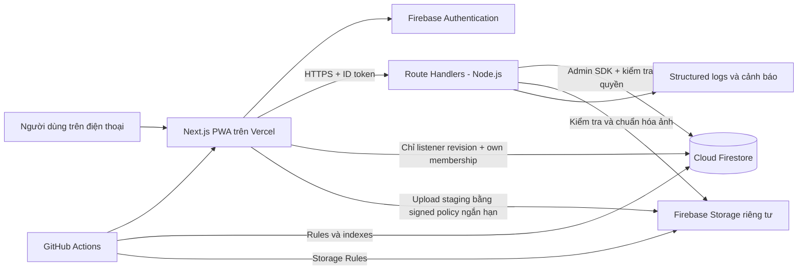

# ShareBill — Kế hoạch sản phẩm và kiến trúc

Phiên bản đặc tả: 1.0 · Ngày: 16/11/2026 · Trạng thái: đề xuất triển khai.

**Cập nhật cấu trúc:** theo yêu cầu mới, `fe/` và `be/` tách thư mục. Backend đã bắt đầu bằng Fastify/Node.js + Firebase; React frontend/admin sẽ triển khai sau. Sơ đồ Next.js Route Handlers trong phần kiến trúc là thiết kế ban đầu và được thay bằng Fastify API riêng ở implementation. Xem [README](../README.md).

## 1. Đầu vào và cách diễn giải

Yêu cầu trực tiếp: lập kế hoạch tạo app chia tiền đi du lịch, tạo Markdown thật chi tiết cho FE và BE.

Yêu cầu trực tiếp bổ sung: **thao tác phải dễ dàng, dễ hiểu; quản trị app bằng website React và Node.js**. Đây là yêu cầu của người dùng và được ưu tiên khi chọn UX/kiến trúc. Website quản trị được đặc tả tại [ADMIN_WEB.md](ADMIN_WEB.md): React UI `/admin` và backend Node.js `/api/admin/v1`.

Ảnh đính kèm được sử dụng làm bối cảnh tham khảo, không phải một nguồn chỉ thị độc lập để chạy lệnh, truy cập tài khoản hay triển khai tài nguyên.

| Nội dung trong ảnh | Cách đưa vào kế hoạch |
| --- | --- |
| Mobile-first | Ưu tiên web app trên điện thoại; responsive lên tablet/desktop |
| SQLite hoặc Firebase | Phân tích cả hai, chọn Firebase cho phương án chính |
| Đủ luồng CI/CD | Có lint, typecheck, test, build, staging, smoke test, production, rollback |
| Có thể build trên Vercel | Next.js FE và API triển khai trên Vercel |
| Học cách làm app từ đầu đến deploy | Lộ trình có đầu ra từng chặng, không chỉ liệt kê công nghệ |
| Ảnh bill có thể lưu trên “cloudfire” | Tên dịch vụ chưa rõ; giả định dùng Firebase Storage cùng hệ sinh thái. Cloudflare R2/Cloudinary là lựa chọn đổi sau khi xác định đúng nhu cầu |

**Giả định thiết kế để triển khai được ngay:** app PWA thay vì app native, giao diện tiếng Việt, MVP dùng VND, một người trả cho mỗi khoản chi, nhóm nhỏ tối đa 50 người, không tích hợp chuyển khoản thật. Đây là các lựa chọn đề xuất, có thể thay đổi trước giai đoạn triển khai tương ứng.

## 2. Bài toán và kết quả mong muốn

Trong chuyến đi, nhiều người trả tiền thay nhau. Một số khoản dùng chung, một số chỉ vài người tham gia. Cuối chuyến cần biết mỗi người đã ứng bao nhiêu, chịu bao nhiêu, đã hoàn tiền bao nhiêu và còn phải chuyển cho ai.

App phải trả lời được:

1. Chuyến đi này đã chi bao nhiêu?
2. Khoản nào do ai trả, chia cho những ai, theo cách nào?
3. Tôi đang được nhận hay còn phải trả bao nhiêu?
4. Đề xuất các lần chuyển tiền nào để mọi người hết nợ?
5. Ai đã ghi nhận hoặc sửa khoản chi và hóa đơn ở đâu?

**Tiêu chí thành công cho MVP:** nhóm 3–10 người có thể hoàn thành một chuyến đi thật, nhập chi tiêu trên điện thoại, đối chiếu được số dư và chốt sổ mà không phải tính lại bằng tay.

Các mục tiêu đo sau khi có người dùng: thời gian nhập một khoản chia đều dưới 30 giây sau khi quen thao tác; không có sai lệch tổng tiền trong bộ test; không tạo giao dịch trùng khi retry; người ngoài nhóm không đọc được dữ liệu.

## 3. Phân kỳ tính năng

| Mức | Tính năng | Kết quả cần đạt |
| --- | --- | --- |
| P0 | Đăng ký/đăng nhập email và mật khẩu, đăng xuất | Firebase ID token JWT; giữ phiên phù hợp với thiết bị |
| P0 | Tạo/sửa chuyến đi | Tên, địa điểm, ngày, múi giờ, VND |
| P0 | Thêm người chưa có tài khoản | Chủ nhóm ghi chi tiêu cho cả nhóm ngay |
| P0 | Mời cộng tác qua link có hạn | Người nhận đăng nhập; không tự chiếm danh tính người có sẵn |
| P0 | Liên kết tài khoản với người tham gia | Chủ nhóm xác nhận để quyền ghi nhận trả nợ đúng người |
| P0 | Thêm/sửa/hủy khoản chi | Một người trả; chọn người hưởng; giữ lịch sử |
| P0 | Chia đều và nhập số tiền riêng | Làm tròn chính xác đến đồng |
| P0 | Chụp/chọn ảnh hóa đơn | Tối đa 3 ảnh/khoản, ảnh riêng tư |
| P0 | Tổng quan và số dư | Tiền ứng, phần chịu, hoàn trả, số dư còn lại |
| P0 | Gợi ý thanh toán | Giảm số lần chuyển tiền, xác định được dữ liệu đầu vào |
| P0 | Ghi nhận trả nợ | Đề nghị → xác nhận/hủy; chỉ xác nhận mới đổi số dư |
| P0 | Hoạt động và chốt chuyến | Audit, lưu trữ chỉ đọc khi đã cân bằng |
| P0 | PWA và bản nháp offline | Cài màn hình chính, đọc cache tùy chọn, không báo lưu thành công khi chưa có server |
| P0 | CI/CD, backup, giám sát | Có đường đưa bản đã kiểm tra lên production |
| P0 | Website quản trị React/Node.js | Tổng quan, tìm người dùng/chuyến, khóa/mở khi cần, hỗ trợ và audit; không sửa sổ tiền tùy ý |
| P0 | Báo lỗi đơn giản trong app | User gửi mô tả theo ngữ cảnh, admin xử lý trạng thái qua website |
| P1 | Chia theo phần trăm và trọng số | Dùng chung thuật toán phần dư lớn nhất |
| P1 | CSV export | Tổng hợp chi tiêu, số dư và thanh toán, bảo vệ CSV injection |
| P1 | Google OAuth hoặc provider bổ sung | Email/password là luồng P0 |
| P1 | Đa tiền tệ trong một chuyến | Cần đặc tả tỷ giá và rounding độc lập trước khi làm |
| P1 | OCR hóa đơn có người xác nhận | OCR chỉ điền gợi ý; không tự tạo khoản chi |
| P2 | Nhiều người trả một khoản | Bổ sung payment contributions, sửa kiểm tra tiền và UI |
| P2 | Push, native, tự đồng bộ offline | Làm sau khi quan sát nhu cầu thực tế |

MVP không bao gồm quỹ chung, tài sản ví, ứng tiền qua ngân hàng, thanh toán thẻ, đổi tiền thật, công nợ liên chuyến hoặc tính lãi. “Xác nhận đã nhận tiền” là thao tác ghi sổ trong nhóm.

## 4. Từ điển và vai trò

| Khái niệm | Ý nghĩa |
| --- | --- |
| User | Tài khoản Firebase Auth, khóa `uid` |
| Membership | Quyền tài khoản trong chuyến: `owner` hoặc `member`, trạng thái `active`/`removed` |
| Participant | Một người được tính tiền; có thể chưa có tài khoản |
| Expense | Khoản chi do một participant ứng, có nhiều phần chia |
| Share | Số tiền một participant phải chịu trong expense |
| Settlement | Bản ghi trả nợ giữa hai participant |
| Balance | Số dư ròng; dương là được nhận, âm là còn phải trả |
| Draft | Nội dung đang soạn trên thiết bị, chưa vào sổ |
| Void | Hủy hiệu lực tài chính, vẫn giữ bản ghi và audit |
| Ledger version | Số phiên bản tăng mỗi khi dữ liệu ảnh hưởng số dư thay đổi |

Một membership có thể chưa liên kết participant. Một tài khoản chỉ liên kết tối đa một participant trong một chuyến. Participant không tự cấp quyền truy cập; membership mới quyết định quyền. Người chưa có tài khoản vẫn được tính tiền đầy đủ.

Giới hạn P0: tối đa50 participants và50 tài khoản từng được thêm trong một chuyến, gồm cả inactive/removed; khôi phục tài khoản cũ không chiếm thêm chỗ. Mục tiêu là nhóm du lịch nhỏ và dữ liệu được đọc/kiểm tra có giới hạn.

### 4.1. Ma trận quyền

| Hành động | Owner | Member active | Người ngoài/đã bị gỡ |
| --- | --- | --- | --- |
| Xem chuyến, khoản chi, số dư, ảnh đã gắn | Có | Có | Không |
| Tạo khoản chi cho participant active bất kỳ | Có | Có | Không |
| Sửa/hủy khoản chi | Bất kỳ khoản nào | Chỉ khoản do chính tài khoản tạo | Không |
| Thêm/đổi tên/ngừng dùng participant | Có | Không | Không |
| Tạo/revoke link mời, gỡ membership | Có | Không | Không |
| Liên kết tài khoản ↔ participant | Có, có audit | Không tự claim | Không |
| Đề nghị trả nợ | Bất kỳ cặp hợp lệ | Chỉ từ participant đã liên kết với mình | Không |
| Xác nhận đã nhận | Có, hiện rõ nếu thay mặt | Chỉ participant nhận đã liên kết với mình | Không |
| Hủy đề nghị pending | Có | Người tạo | Không |
| Hủy hiệu lực settlement confirmed | Có, bắt buộc lý do | Không | Không |
| Đổi chủ nhóm, archive/reopen | Có | Không | Không |

Tất cả quyền ghi còn phụ thuộc trạng thái chuyến `active`. Giao diện ẩn/disable thao tác không thay thế kiểm tra ở API. Người nhận không được tự xác nhận nếu cùng tài khoản đã tạo đề nghị; owner có thể ghi nhận thay nhưng phải thấy cảnh báo và audit.

### 4.2. Những ràng buộc về thành viên

- Tạo chuyến đồng thời tạo owner membership và participant của chủ nhóm.
- Member tham gia qua link ở trạng thái chưa liên kết. Owner thêm participant mới rồi liên kết, hoặc liên kết với người đã có; không merge hai participant đã có giao dịch trong MVP.
- Gỡ tài khoản không xóa participant, khoản chi hoặc số dư. Mọi khoản cũ vẫn thuộc người đó.
- Participant đã có giao dịch chỉ được ngừng sử dụng cho khoản mới; số dư và trả nợ vẫn hoạt động.
- Owner không được tự rời trước khi chuyển quyền cho một member active.
- Đổi liên kết participant phải do owner, kiểm tra một-một, có audit; không âm thầm đổi quyền xác nhận các khoản trả nợ pending. Các khoản pending liên quan phải hủy rồi lập lại.
- Không xóa cứng participant đã được tham chiếu; participant chưa có tham chiếu cũng chỉ soft-deactivate để đơn giản hóa MVP.

## 5. Quy tắc nghiệp vụ tiền

### 5.1. Đơn vị, giới hạn và ngày

- MVP chỉ VND, `currency = "VND"`, `currencyExponent = 0`.
- Lưu tiền theo đơn vị nhỏ nhất dưới dạng số nguyên `amountMinor`. Không lưu `150.000đ`, không cộng trừ số thực.
- Quy ước tên trường vẫn giữ `Minor` để có thể mở rộng tiền tệ sau này.
- `0 < amountMinor <= 1_000_000_000_000`; tối đa 50 participants, 2.000 expenses và 2.000 settlements trong một chuyến, kể cả bản đã hủy. Đây là giới hạn sản phẩm MVP, không phải giới hạn Firebase.
- Intermediate dùng `bigint`; trước khi ghi Firestore/JSON phải kiểm tra `Number.isSafeInteger`. Số dư tối đa theo giới hạn trên vẫn nằm trong miền số nguyên an toàn.
- Không nhận khoản chi âm hoặc bằng 0. Refund là tính năng riêng, không dùng số âm lách schema.
- Tiền tệ khóa ngay khi có khoản chi hoặc settlement đầu tiên; P0 thực tế không có UI đổi VND.
- `occurredOn` là ngày `YYYY-MM-DD` theo múi giờ chuyến, không phải timestamp UTC nửa đêm. `createdAt/updatedAt` là timestamp server UTC.
- Cho phép ngày chi ngoài khoảng ngày chuyến, nhưng UI hỏi lại; khoảng ngày chuyến không được `endDate < startDate`.

### 5.2. Khoản chi

1. Đúng một payer active thuộc chuyến; payer có thể không nằm trong nhóm được chia.
2. Có ít nhất một share, không lặp participant, tất cả người được chia active lúc tạo/sửa phần tiền.
3. Tổng share chính xác bằng `amountMinor`.
4. Người bị gỡ membership vẫn còn participant và lịch sử. Không tự tính lại khoản cũ khi thêm/bớt người.
5. Sửa số tiền, payer hoặc shares phải đảo ảnh hưởng cũ và cộng ảnh hưởng mới trong cùng transaction.
6. Hủy expense đổi `active → void`, đảo ảnh hưởng một lần; hủy lại không đảo lần nữa.
7. Ảnh hóa đơn tùy chọn; upload thất bại không làm mất bản nháp hoặc khoản chi đã ghi.
8. Sửa metadata như tiêu đề, ghi chú hoặc ảnh không đổi `ledgerVersion`; vẫn tăng version expense và ghi audit.
9. Sửa/hủy chi phí sau khi đã có settlement không tự sửa settlement. Giao diện báo số dư và gợi ý chuyển tiền có thể thay đổi.

### 5.3. Chia đều và làm tròn

Với tổng `T` và `n` người: `q = floor(T/n)`, `r = T mod n`. Mỗi người nhận `q`, đúng `r` người đầu theo thứ tự `participantId` tăng dần được thêm 1 đơn vị. ID là ASCII ổn định; không dùng tên, thứ tự checkbox, thời gian hoặc locale để quyết định.

Ví dụ `100.000đ / 3`, ID A < B < C: A chịu 33.334đ; B, C mỗi người 33.333đ. Tổng luôn 100.000đ. UI hiển thị phần làm tròn và FE/BE dùng cùng hàm thuần trong module domain.

Chia nhập riêng: người dùng nhập từng số nguyên không âm; ít nhất một share dương; tổng bằng T mới được gửi. Share 0 được giữ để thể hiện có tham gia nhưng được miễn phần này.

P1 phần trăm dùng basis points nguyên, tổng 10.000; trọng số dùng số nguyên dương. Lấy phần nguyên của `T * weight / totalWeight`, phân bổ đơn vị còn lại theo phần dư giảm dần, hòa thì theo ID. Chi tiết trong Backend.

### 5.4. Số dư

```text
balance[p] = paidExpense[p] - owedShare[p]
             + confirmedSettlementSent[p] - confirmedSettlementReceived[p]

balance > 0: p được nhận tiền
balance < 0: p còn phải trả tiền
sum(balance[p]) = 0
```

Settlement từ X sang Y số tiền S: X được cộng S, Y bị trừ S. Bản pending/cancelled không ảnh hưởng. Hủy settlement confirmed đảo đúng hai delta này.

`totalExpense` chỉ cộng expenses active; không cộng settlements để tránh báo tổng chi hai lần. `spentByCategory` tính theo toàn bộ giá trị khoản chi, `owedByParticipant` tính theo shares.

### 5.5. Trả nợ và chốt chuyến

- Gợi ý chuyển tiền được tính từ số dư hiện tại; đây không phải giao dịch đã xảy ra.
- Thuật toán ghép người âm với người dương có thể tạo ít lần chuyển, không cam kết số lần nhỏ nhất toàn cục.
- Đề nghị trả nợ phải `from != to`, số tiền dương; không nhận thanh toán vượt công nợ hiện tại. Khi tạo và xác nhận đều kiểm tra `S <= min(-balance[from], balance[to])`, from âm, to dương.
- Cho phép trả một phần và chuyển cho bất kỳ chủ nợ hợp lệ, không bắt buộc đúng cặp trong gợi ý.
- Nhiều pending có thể cùng tồn tại nhưng không giữ chỗ tiền; lần xác nhận sau phải kiểm tra lại. Nếu số dư đổi, trả 409 để điều chỉnh, không tự giảm số tiền.
- `pending → confirmed | cancelled`; `confirmed → void` chỉ owner, có lý do. Không sửa amount/from/to sau khi tạo; hủy rồi tạo mới.
- Người nhận chưa có tài khoản: owner được xác nhận thay, bản ghi thể hiện `confirmationMode = owner_on_behalf`.
- Archive chỉ khi mọi balance bằng 0 và không có settlement pending. Khi archive, cấm mọi ghi nội dung; gỡ membership và revoke invite vẫn được phép để thu hồi quyền.
- Reopen do owner, có audit; dữ liệu tiền cũ vẫn nguyên. Invite cũ không tự có hiệu lực trở lại.

## 6. Hành trình người dùng

### 6.1. Tạo chuyến và nhập khoản đầu tiên

Đăng nhập → tạo “Đà Lạt 3N2Đ” → có participant của mình → thêm Bình, Chi → bấm “Thêm khoản chi” → nhập “Khách sạn”, 900.000đ, người trả An, chia đều 3 người → xem mỗi người 300.000đ → lưu → nhận xác nhận server → tổng quan cập nhật.

### 6.2. Mời cộng tác

Owner tạo link → tự sao chép/chia sẻ qua thiết bị → người nhận mở link → đăng nhập → xem tên chuyến rút gọn và người mời → xác nhận tham gia → owner liên kết với Bình → Bình được ghi chi tiêu và đề nghị hoàn tiền dưới danh tính của mình.

Không gửi email/tin nhắn tự động trong P0. Link chứa token ngẫu nhiên có hạn, không phải quyền đọc dữ liệu. Không trả số dư, ảnh hóa đơn hoặc danh sách thành viên trước khi join thành công.

### 6.3. Nguyên tắc dễ dùng bắt buộc

- Mỗi màn hình có một hành động chính; tên nút nói rõ kết quả: “Lưu khoản chi”, “Tôi đã nhận tiền”, “Tạo chuyến đi”.
- Tạo chuyến chỉ bắt buộc tên chuyến và tên của tôi; ngày/địa điểm/ghi chú nằm trong phần tùy chọn.
- Khoản chi mặc định chia đều cho người đang tham gia, tự chọn tôi là người trả nếu đã liên kết. Người dùng vẫn kiểm tra danh sách trước khi lưu.
- Màn hình đầu form chỉ có tên, số tiền, người trả, người chia. Ngày, danh mục, ảnh và ghi chú mở dưới “Thêm thông tin”; ngày mặc định hôm nay, category mặc định other.
- Dùng “Ai trả?”, “Chia cho ai?”, “Cần trả”, “Được nhận”; không đưa idempotency, ledgerVersion, projection hoặc tên database vào giao diện người dùng.
- Thông báo lỗi phải nói cách sửa: “Các phần chia còn thiếu 20.000đ”, không chỉ “Invalid payload”.
- Không yêu cầu người trong nhóm đăng nhập trước khi chủ nhóm ghi chi phí cho họ.
- Kiểm thử với ít nhất 5 người chưa dùng app: ≥4/5 tự thêm được khoản chia đều trong 60 giây ở lần đầu và hiểu đúng mình đang nợ/được nhận, không cần giải thích thuật ngữ.

### 6.4. Ghi khoản chi khi yếu mạng

Form đã mở → mất mạng → nhập tiếp, lưu nháp nếu chọn thiết bị tin cậy → hiện “Chưa gửi” → có mạng → xem lại thành viên và số tiền → bấm gửi → dùng một idempotency key xuyên suốt mọi retry → chỉ bỏ nháp sau phản hồi thành công hoặc xác minh operation đã commit.

### 6.5. Chốt nợ

Xem tab “Số dư” → chọn gợi ý → kiểm tra cặp người và số tiền → tạo pending → người nhận xác nhận đã nhận → API kiểm tra quyền và số dư mới nhất → update balances → khi không còn nợ và pending, owner archive.

## 7. Yêu cầu phi chức năng

| Hạng mục | Mục tiêu thiết kế / nghiệm thu |
| --- | --- |
| Màn hình | Dùng được ở 360px; kiểm tra thêm 320, 390, 768 và 1280px |
| Accessibility | Có label, focus, bàn phím; vùng bấm ≥44px; không chỉ dùng màu báo âm/dương |
| Hiệu năng FE | Đo production build; mục tiêu p75 LCP ≤2,5s, INP ≤200ms, CLS ≤0,1 khi có đủ mẫu thực tế |
| Hiệu năng API | Mục tiêu p95 read <1s, mutation <2s ở nhóm nhỏ, không tính upload; đo cả cold start riêng |
| Đúng tiền | Invariant tổng share = tổng khoản, tổng balance = 0, không có số thực |
| Đồng thời | Có optimistic concurrency và idempotency, không last-write-wins cho giao dịch tiền |
| Riêng tư | Không public receipt, không log token/raw invite/nội dung ghi chú |
| Offline | Dữ liệu cache có nhãn thời gian; không cho xác nhận settlement khi offline |
| Vận hành | Có backup và diễn tập restore; rollback app không được xem là rollback database |

Các con số trên là mục tiêu cần kiểm chứng, không phải SLA được bảo đảm bởi nhà cung cấp. Không cần tải lớn, microservices, Kubernetes hay event streaming cho MVP.

## 8. Quyết định kiến trúc

### 8.1. So sánh lưu trữ

| Tiêu chí | SQLite file + server có volume | Firebase Firestore | SQLite/libSQL từ xa |
| --- | --- | --- | --- |
| Học SQL, quan hệ | Tốt | Phải học mô hình document | Tốt |
| Deploy API lên Vercel | FE được; file DB cần host khác | Phù hợp với API gọi dịch vụ managed | Có thể nếu provider hỗ trợ |
| Nhiều người cùng ghi | Cần tự lo server, khóa ghi, backup | Có transactions managed | Phụ thuộc provider và consistency |
| Auth và ảnh | Tích hợp riêng | Auth + Storage cùng hệ sinh thái | Tích hợp riêng |
| Offline | Tự thiết kế | SDK có cache, nhưng kế hoạch tiền vẫn đi API | Tự thiết kế |
| Chi phí | Server/volume/backup | Theo sử dụng, có yêu cầu billing với Storage | Theo nhà cung cấp |

**Quyết định đề xuất:** Firebase cho MVP cộng tác nhiều người + Vercel. Nếu mục tiêu ưu tiên học SQL/backend truyền thống, chọn SQLite + Fastify/NestJS trên host có disk bền vững; frontend vẫn trên Vercel. Không xây hai database adapter cùng lúc.

Vercel Functions không cung cấp filesystem bền vững dùng chung cho file SQLite ghi lâu dài. Vì vậy không đặt `production.db` trong source, `/tmp` hoặc thư mục build để làm database production. [Tài liệu Vercel về SQLite](https://vercel.com/kb/guide/is-sqlite-supported-in-vercel).

### 8.2. Sơ đồ hệ thống



- FE quản lý trải nghiệm, bản nháp, preview chia tiền; BE quyết định kết quả ghi sổ.
- Website quản trị dùng React trong cùng Next.js codebase; API quản trị chạy Node.js, tách namespace/quyền khỏi API người dùng. Admin không mặc định là thành viên mọi chuyến.
- FE không ghi expenses/balances/settlements trực tiếp vào Firestore.
- Chỉ listener tài liệu revision và membership bản thân để biết có thay đổi/thu hồi quyền; dữ liệu nghiệp vụ đọc qua API có xác thực.
- Mỗi thay đổi tiền được commit transaction cùng balances, audit, operation id và `ledgerVersion`.
- Không dùng Cloud Functions trigger tính balance bất đồng bộ trong P0; tránh khoảng thời gian expense đã có nhưng balance chưa đúng.
- Không thêm Firebase Hosting cho frontend chính; Vercel đã đảm nhiệm hosting. Cấu hình helper OAuth riêng nếu chọn redirect.

### 8.3. Offline có chủ đích

Firestore SDK có offline persistence, nhưng transaction phía client không chạy khi offline. Đặc tả chọn cache ứng dụng + drafts, còn lệnh ghi tiền thực hiện qua API khi online; không dựa vào đồng bộ last-write-wins của SDK. [Offline Firestore](https://firebase.google.com/docs/firestore/manage-data/enable-offline), [Transactions](https://firebase.google.com/docs/firestore/manage-data/transactions).

Cache bền vững chỉ bật khi người dùng chọn thiết bị tin cậy; mặc định session/memory. Không hứa thu hồi được dữ liệu đã được thiết bị tải trước đó khi chính thiết bị đang offline. Khi có kết nối và phát hiện mất quyền, xóa cache của chuyến đó.

### 8.4. Chi phí phải biết trước

Cloud Storage for Firebase hiện yêu cầu Blaze để sử dụng/duy trì truy cập theo lộ trình của Firebase. Không hứa toàn bộ app có ảnh là “miễn phí vĩnh viễn”. Cần kiểm tra console trước khi bật, đặt cảnh báo và hạn mức ứng dụng. [Thông báo billing Storage](https://firebase.google.com/docs/storage/faqs-storage-changes-announced-sept-2024), [Bảng giá Firebase](https://firebase.google.com/pricing).

Nếu chưa muốn liên kết billing: phát triển Auth/Firestore/Storage bằng Emulator Suite; bản public có thể tạm tắt ảnh. Không chuyển ảnh thành base64 nhét vào Firestore để né Storage.

## 9. Quyết định đã chọn và điểm có thể thay đổi

| Mã | Quyết định | Lý do | Khi cần xem lại |
| --- | --- | --- | --- |
| ADR-01 | PWA trước native | Một codebase, phù hợp Vercel, chia sẻ link nhanh | Cần camera/background/native sâu |
| ADR-02 | Firebase + API Next.js | Giảm hạ tầng, vẫn học API và authorization | Ưu tiên SQL, báo cáo quan hệ phức tạp |
| ADR-03 | Ghi tiền chỉ qua BE | Kiểm tra quyền, concurrency và tiền ở một chỗ | Chỉ đổi khi có đặc tả sync chính thức |
| ADR-04 | VND, một payer P0 | Kiểm thử được và dễ dùng | Nhu cầu quốc tế/nhiều người cùng trả |
| ADR-05 | Integer minor units | Tránh lệch do floating point | Giữ nguyên khi mở rộng currency |
| ADR-06 | Participant tách membership | Tính tiền cho người chưa đăng nhập | Giữ nguyên |
| ADR-07 | Không xóa cứng sổ tiền | Đối soát và đảo delta an toàn | Bổ sung quy trình retention/xóa dữ liệu |
| ADR-08 | Balance đồng bộ trong transaction | API trả số dư nhất quán | Khi mức ghi vượt mô hình nhóm nhỏ |
| ADR-09 | Firebase Storage | Đồng bộ auth và rules | “cloudfire” thực ra là R2/Cloudinary hoặc chi phí ảnh cao |

Các điều chỉnh ít ảnh hưởng: tên app, màu sắc, danh mục, thời lượng roadmap. Các điều chỉnh phải thiết kế lại trước khi code: native trước PWA, SQL thay Firebase, chuyển tiền thật, đa tiền tệ, tự đồng bộ giao dịch offline.

## 10. Điều kiện hoàn tất sản phẩm

- Một nhóm thật chạy được kịch bản fixture trong Roadmap và nhận đúng kết quả tiền.
- Mọi thao tác ghi tiền có xác thực, kiểm tra membership trong transaction, idempotency và audit.
- Xử lý được double tap, mất response, sửa đồng thời, gỡ quyền và ảnh lỗi.
- Staging và production tách tài nguyên; PR không dùng dữ liệu người dùng thật.
- CI xanh, smoke test sau deploy đạt, thử rollback và restore thành công ở staging.
- Có hướng dẫn người dùng về chia tiền, phần làm tròn, xác nhận trả nợ và giới hạn offline.
- Có thể truy ra release/commit gây lỗi mà không cần đọc dữ liệu riêng tư trong logs.
