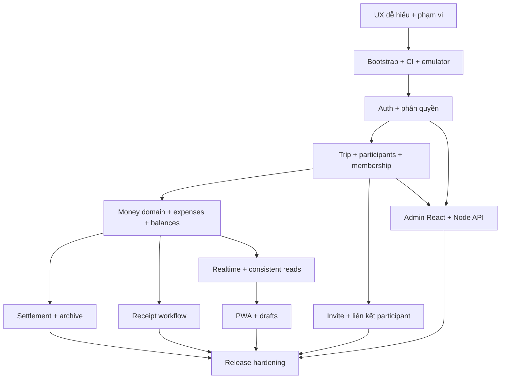

# ShareBill — Lộ trình triển khai, backlog và kiểm thử

Phiên bản 1.0 · 16/11/2026 · Phạm vi gồm app mobile-first và website quản trị React/Node.js.

## 1. Cách dùng lộ trình

Ưu tiên BE trước theo yêu cầu dự án: mỗi lát backend hoàn thiện API/dữ liệu/test cho một hành vi, sau đó lát FE ghép màn hình vào API đã nghiệm thu. Sau mỗi chặng phải demo được bằng API, script hoặc giao diện tương ứng.

**Danh sách công việc thực thi:** [105 lát cắt nhỏ](slices/README.md), chia thành CSDL, nghiệp vụ BE, ảnh hóa đơn, FE app, admin và vận hành. Mỗi lát có mã/phụ thuộc/phạm vi file/kiểm thử/điều kiện hoàn tất. Bắt đầu D01; các giai đoạn và backlog lớn dưới đây là mốc tổng quan, không phải đơn vị giao việc một lần.

Ước lượng dành cho một người đã biết JavaScript/React cơ bản: **10–14 tuần làm tập trung**, bao gồm admin website và vận hành tối thiểu. Người vừa học vừa làm bán thời gian có thể cần **16–24 tuần hoặc hơn**. Đây là giả định lập kế hoạch, không deadline đã cam kết; chốt lại sau bootstrap và hai luồng đầu.

Muốn ra bản thử sớm: hoàn thành giai đoạn0–4, deploy staging không public rộng; tiếp tục settlement, ảnh, admin, offline và kiểm thử trước khi gọi là MVP hoàn chỉnh. Tính năng ảnh có thể tắt nếu chưa sẵn sàng billing, nhưng phải ghi rõ giới hạn bản thử.

## 2. Các giai đoạn và cổng nghiệm thu

| Giai đoạn | Thời lượng tham khảo | Công việc FE | Công việc BE/DevOps | Đầu ra phải demo |
| --- | --- | --- | --- | --- |
| 0. Chốt trải nghiệm | 2–3 ngày | Prototype form đơn giản, thử từ ngữ | Chốt phạm vi P0, tiền và quyền | Người mới hiểu tạo chuyến/nhập chi/đọc nợ |
| 1. Nền dự án | 3–5 ngày | Shell React mobile + admin, tokens | Node API skeleton, emulator, CI checks | App local chạy, pipeline xanh |
| 2. Auth và quyền | 3–5 ngày | Email/password, session states | Register/login/refresh JWT, verify token, user bootstrap, admin guard | User thường bị chặn admin |
| 3. Trip và participants | 4–6 ngày | Tạo chuyến, thêm người, danh sách | Schema, owner/membership/link | Chủ nhóm thêm người chưa có tài khoản |
| 4. Expense và balances | 7–10 ngày | Form một màn hình, equal/exact, detail | Domain money, transaction, audit/op | Fixture tiền khớp và retry không trùng |
| 5. Trả nợ và chốt | 4–6 ngày | Suggestions, pending/confirm/void | Settlement state machine, archive/reopen | Partial payment rồi chốt đúng |
| 6. Ảnh hóa đơn | 3–5 ngày | Camera, upload, progress, lỗi | Intent, Rules, processing lease, private view | Ảnh chỉ đúng người có quyền xem |
| 7. Admin và hỗ trợ | 5–8 ngày | 6 mục admin, search, confirm dialogs | Admin API, moderation jobs, tickets | Tìm user, khóa trip, xử lý ticket |
| 8. Realtime và PWA | 4–6 ngày | Signals, install, snapshot/draft | Signal writes, consistent reads | Offline nháp, online review rồi gửi |
| 9. Hardening và release | 5–8 ngày | Device/accessibility/usability fixes | CI/CD, backup/restore, monitoring | Staging rehearsal, production smoke |

Các chặng có thể gối nhau theo dependency, nhưng không bỏ gate về tiền/quyền để giữ lịch. Dành khoảng15–25% thời gian cho sửa lỗi/tích hợp thay vì lấp đầy lịch bằng tính năng mới.

## 3. Dependency và thứ tự ưu tiên

Không làm OCR/đa tiền tệ trước khi shares, idempotency, membership và settlement ổn định. Không đặt yêu cầu viết xong toàn bộ admin trước khi có dữ liệu trip để demo.

### 3.1. Công việc CSDL cần hoàn thiện

Theo [thiết kế CSDL](DATABASE.md), thực hiện DB-02 (schema/factory) → DB-03 (bổ sung dữ liệu writer) → DB-04 (migration/checker), sau đó DB-05..08 theo tính năng; DB-09 là gate staging/restore. Các việc này nằm trong giai đoạn BE bên trên, không cộng nguyên ước lượng CSDL một lần nữa vào tổng lịch.

| Hạng mục CSDL | Trạng thái hiện tại | Điều kiện đóng |
| --- | --- | --- |
| DB-01: thiết kế và index | Đã có DATABASE.md, 16 composite index và field exemptions | Index inventory đồng bộ từng query khi triển khai |
| Dữ liệu mẫu | Có script `db:seed` cho emulator qua API | Assertion tổng chi/số dư/pending đạt; không trỏ được cloud |
| DB-02..03: schema/writers | Chưa hoàn tất | Field đủ, owner link ba chiều, audit/operation chuẩn |
| DB-04: migration/checker | Đã thiết kế DBM-001..007, chưa có runner | Dry-run/checkpoint/rerun không đổi tiền; checker không diff |
| DB-05..08: lifecycle và admin | Còn thiếu các API/workers liệt kê trong DATABASE.md | Test transaction/quyền/lifecycle của từng nhóm đạt |
| DB-09: staging/restore | Chưa chạy cloud | Index ready, query thật/concurrency/restore đạt |

Ma trận DATA-01..16 và checklist nghiệm thu ở cuối DATABASE.md là gate CSDL v1. Seed sử dụng writer hiện tại nên không là chứng nhận schema v1 hoặc migration đã hoàn tất.

## 4. Backlog có acceptance criteria

| ID | Hạng mục | Tiêu chí hoàn tất cụ thể | Phụ thuộc |
| --- | --- | --- | --- |
| UX-01 | Prototype 3 màn hình chính | Tạo chuyến, thêm expense, số dư; người mới diễn giải đúng | — |
| UX-02 | Prototype admin | Tìm user → detail → khóa có reason; không cần biết DB | UX-01 |
| BASE-01 | Repo chuẩn | strict TS, scripts, lockfile, env.example, gitignore | — |
| BASE-02 | CI không secrets | PR chạy lint/types/domain/build với demo config | BASE-01 |
| BASE-03 | Emulators và seed | Auth/Firestore/Storage local; reset chỉ demo project | BASE-01 |
| AUTH-01 | Email/password đăng ký/đăng nhập | Validation, trùng email, sai mật khẩu, disabled/offline đúng UX, returnTo an toàn | BASE-01 |
| AUTH-02 | API verification | Không token401; revoked/disabled bị chặn | AUTH-01 |
| AUTH-03 | Cache isolation | Logout/đổi user không hiện dữ liệu user cũ | AUTH-01 |
| TRIP-01 | Tạo trip nguyên tử | Root + owner + participant + balance0 + ref/op tạo một lần | AUTH-02 |
| TRIP-02 | Participants | Owner thêm/sửa/inactive, không đổi shares cũ | TRIP-01 |
| TRIP-03 | Mời và join | Hạn/lượt/revoke/epoch đúng, join không tự claim người | TRIP-01 |
| TRIP-04 | Link và owner transfer | Unique hai chiều, member bị gỡ không mất ledger | TRIP-02/03 |
| MONEY-01 | Tiền và chia | equal/exact deterministic, integer, bounds, property tests | BASE-01 |
| EXP-01 | Tạo expense | Một form, response server đúng, balance/stat/audit/op atomic | TRIP-02, MONEY-01 |
| EXP-02 | Sửa/hủy | Old delta đảo + new delta cộng đúng, có If-Match/reason | EXP-01 |
| EXP-03 | Retry và conflict | Double tap/timeout cùng key chỉ một commit; conflict không ghi đè | EXP-01/02 |
| BAL-01 | Overview snapshot | Tổng chi/số dư cùng ledgerVersion; không tính từ paginated list | EXP-01 |
| BAL-02 | Suggestions | Mọi đề xuất triệt tiêu net, đúng dấu, deterministic | BAL-01 |
| SET-01 | Pending/confirm | Chỉ confirm đổi tiền, actor đúng, không overpay | BAL-02 |
| SET-02 | Cancel/void | State machine đúng; void không áp dụng hai lần | SET-01 |
| TRIP-05 | Archive/reopen | Zero net và zero pending mới archive, concurrent writes đúng | SET-01 |
| IMG-01 | Upload intent/policy/rules | Chặn mint sai quyền, policy giới hạn path/size/type/expiry; client SDK deny | TRIP-01 |
| IMG-02 | Finalize/attach/view | Lease/generation kiểm đúng, private URL, max3 | IMG-01, EXP-01 |
| IMG-03 | Cleanup | Không xóa ảnh attached kể cả expense void; dry-run rõ | IMG-02 |
| ADM-01 | Admin allowlist | User/owner403, active admin200, revoke có hiệu lực | AUTH-02 |
| ADM-02 | Admin dashboard/search | Counts có timestamp; exact email/UID/tripID; pagination | ADM-01 |
| ADM-03 | Moderation | User disable/enable job, trip suspend/resume đúng, reason/audit | ADM-01, TRIP-01 |
| ADM-04 | Support tickets | User chỉ đọc ticket mình; internal note admin-only | ADM-01 |
| ADM-05 | Admin usability | Admin tìm user/khóa trip/xử lý ticket bằng website | ADM-02/03/04 |
| RT-01 | Signals | Chỉ listen2 docs/chuyến; refresh khi revision tăng; unmount clean | BAL-01 |
| PWA-01 | Cài đặt/shell | Manifest/icons/HTTPS/offline page, update không mất draft | BASE-01 |
| OFF-01 | Snapshot/draft | Opt-in trusted device, timestamp, không auto commit tiền offline | EXP-03, PWA-01 |
| OPS-01 | CD staging/prod | Checks gating, project separation, same SHA đúng env | BASE-02 |
| OPS-02 | Backup/reconcile | Restore project cô lập, invariant0 mismatch, receipt có bytes | EXP-02, IMG-02 |
| OPS-03 | Admin system/runbook | Job summaries an toàn, release SHA, failure messages rõ | ADM-01, OPS-01/02 |
| REL-01 | MVP release | Full acceptance matrix đạt và không còn blocker | Tất cả P0 |

## 5. Dữ liệu mẫu chuẩn để FE/BE đối chiếu

Trip “Đà Lạt 3N2Đ”, VND. IDs sort `p_A < p_B < p_C`, tương ứng An, Bình, Chi. Mỗi người có tài khoản linked để test quyền, sau đó tách Chi thành chưa có tài khoản để test owner ghi nhận thay.

### 5.1. Expenses

| ID | Khoản | Tổng | Người trả | Shares |
| --- | --- | ---: | --- | --- |
| E1 | Khách sạn | 900.000 | An | An300.000, Bình300.000, Chi300.000 |
| E2 | Ăn tối | 180.000 | Bình | An120.000, Bình60.000; Chi không tham gia |
| E3 | Di chuyển | 90.000 | Chi | Bình60.000, Chi30.000; An không tham gia |

### 5.2. Kết quả trước trả nợ

| Người | Đã ứng | Phần chịu | Đã chuyển | Đã nhận | Net |
| --- | ---: | ---: | ---: | ---: | ---: |
| An | 900.000 | 420.000 | 0 | 0 | +480.000 |
| Bình | 180.000 | 420.000 | 0 | 0 | −240.000 |
| Chi | 90.000 | 330.000 | 0 | 0 | −240.000 |
| Tổng | 1.170.000 | 1.170.000 | 0 | 0 | 0 |

Gợi ý: Bình → An240.000; Chi → An240.000. Cùng giá trị hòa thì Bình trước Chi vì ID.

### 5.3. Partial settlement

1. Chi tạo pending120.000 cho An: balances giữ nguyên.
2. An confirm: An net360.000; Bình−240.000; Chi−120.000.
3. Suggestions mới: Bình → An240.000; Chi → An120.000.
4. Xác nhận hai khoản còn lại: cả ba net0; archive được nếu không pending.
5. Owner void khoản confirmed120.000 đầu: An+120.000, Chi−120.000, Bình0 sau reopen; có audit và không chỉnh expense.

Mỗi bước đổi tiền tăng ledgerVersion đúng một lần; tạo pending/cancel không tăng. Retry một bước với cùng key không tăng lần thứ hai.

### 5.4. Sửa/hủy expense

Reset fixture trước settlements. Đổi E2 từ180.000 thành210.000, shares An140.000/Bình70.000:

- Tổng chi1.200.000.
- An paid900.000/owed440.000/net+460.000.
- Bình paid210.000/owed430.000/net−220.000.
- Chi paid90.000/owed330.000/net−240.000.

Void E3 sau đó:

- Tổng chi1.110.000.
- An+460.000, Bình−160.000, Chi−300.000; tổng0.
- E3 vẫn có trong tab Đã hủy với reason và ảnh đính kèm nếu có.

### 5.5. Fixture làm tròn

E4 độc lập: An trả100.000 chia đều An/Bình/Chi. Shares33.334/33.333/33.333; nets An+66.666, Bình−33.333, Chi−33.333. Đảo thứ tự ID input vẫn cùng kết quả. Tổng1đ chia3: shares1/0/0, không tự làm tròn tất cả thành0.

## 6. Chiến lược kiểm thử

- Unit: domain tiền và state transitions; tránh test mirror implementation chỉ để tăng coverage.
- Property-based: tổng share, tổng net, permutation invariance và reversal; hữu ích hơn một loạt snapshot UI giống nhau.
- Integration: API + Firestore emulator + transaction, membership, operation; kiểm DB state thực.
- Rules tests: client SDK cho allow/deny; không dùng Admin SDK để kết luận Rules hoạt động.
- E2E: hành trình người dùng/admin có giá trị, ít nhưng đủ các nhánh quan trọng.
- Manual staging: Email/Password thật, JWT/refresh, signed URLs, billing/config, real device, slow/offline network, backup/restore; emulator không chứng minh mọi hành vi production.
- Không đặt coverage100% cho component trình bày; bắt buộc cover tất cả invariant và quyền mutation quan trọng.

## 7. Test matrix bắt buộc

### 7.1. Money/domain

| ID | Tình huống | Kết quả mong đợi |
| --- | --- | --- |
| M01 | Equal chia hết/không hết/1đ nhiều người | Tổng chính xác, deterministic, không âm |
| M02 | Exact đủ/thiếu/vượt | Chỉ tổng bằng amount mới hợp lệ |
| M03 | Payer không nằm shares | Payer nhận đủ credit; tổng delta0 |
| M04 | Payer đồng thời nhận share | Gộp delta, không ghi đè paid/owed |
| M05 | Share0 nhưng có share dương | Hợp lệ, total đúng |
| M06 | Input decimal/âm/zero/unsafe/duplicate ID | Từ chối, không ghi DB |
| M07 | Financial edit vs metadata edit | Tiền đổi mới tăng ledgerVersion; note/ảnh không tăng |
| M08 | Contribution rồi reverse | Mọi component balance/stats về ban đầu |
| M09 | Suggest trên arbitrary zero-sum balances | Thực hiện suggestions đưa tất cả net0 |
| M10 | Bounds50 người/2.000 bản/10^12 | Không overflow, từ chối vượt product limits |
| M11 | P1 percentage/weights nếu bật | Largest remainder, sum đúng, tie theo ID |

### 7.2. Auth và membership

| ID | Tình huống | Kết quả mong đợi |
| --- | --- | --- |
| A01 | Không token/token giả/sai project | 401, không lộ dữ liệu |
| A02 | User ngoài trip đoán entity ID | 404, không đọc/ghi được |
| A03 | Member sửa expense người khác | 403; owner được phép |
| A04 | Gỡ member trong lúc họ ghi | Transaction serialization quyết định đúng, không vượt quyền snapshot cũ |
| A05 | Participant không có account | Vẫn chia tiền được, không có membership tự phát |
| A06 | Join invite rồi claim participant có sẵn | Không được; owner link mới có quyền identity |
| A07 | Link UID/participant đã gắn | 409, không mất link cũ |
| A08 | Removed user join link cũ | Bị chặn; owner restore rõ ràng |
| A09 | Owner rời/chuyển cho removed user | Bị chặn; không có trip mất owner |
| A10 | Client SDK ghi balances/expenses/admin | Rules deny |
| A11 | Revoked/disabled user gọi API | Bị chặn cả đọc và ghi protected |
| A12 | Bootstrap gọi lại user disabled/admin | Không reset moderation/role |

### 7.3. Concurrency và retry

| ID | Tình huống | Kết quả mong đợi |
| --- | --- | --- |
| C01 | Hai create cùng key/body song song | Một entity, một audit, một contribution |
| C02 | Cùng key, body hoặc If-Match khác | 409, không đổi dữ liệu |
| C03 | Commit xong mất HTTP response | Retry/operation lookup ra đúng kết quả |
| C04 | Hai PATCH cùng expense.version | Một thành công, một VERSION_CONFLICT |
| C05 | Nhiều expense khác nhau cùng trip | Mọi commit đúng, không mất delta, sum0 |
| C06 | Confirm hai pending vượt tổng nợ | Chỉ phần còn đủ công nợ được confirm; lần kia409/422 |
| C07 | Confirm và void expense đồng thời | LedgerVersion/root serialization và revalidation đúng |
| C08 | Archive và create/confirm đồng thời | Không có transaction ghi vào trip đã archived |
| C09 | Transaction callback tự retry | Không tạo side effect/ảnh/audit lặp |
| C10 | Replay sau khi entity đã sửa tiếp | Trả snapshot cũ + replay header, không apply lần nữa |
| C11 | Replay sau khi actor mất membership | 404, không trả response riêng tư |
| C12 | Cursor trang2 sau mutation | CURSOR_STALE, FE reset đúng và không nhân đôi card |

### 7.4. Settlements

| ID | Tình huống | Kết quả mong đợi |
| --- | --- | --- |
| S01 | Pending tạo/cancel | Net không đổi, pending count đúng |
| S02 | Recipient xác nhận | Net/sent/received đúng, ledgerVersion+1 |
| S03 | Creator tự confirm cùng tài khoản | Bị chặn trừ owner ghi nhận thay có nhãn |
| S04 | Participant nhận chưa có account | Owner confirm_on_behalf có audit |
| S05 | From/to trùng, amount quá nợ, ledger cũ | Từ chối theo lỗi hợp đồng |
| S06 | Confirm/void lặp, transition sai | Không apply tiền hai lần |
| S07 | Đã trả một phần rồi expense đổi | Không sửa settlement lịch sử; tính net mới |
| S08 | Relink participant có pending | Bắt hủy/lập lại, không đổi người xác nhận âm thầm |

### 7.5. Ảnh hóa đơn

| ID | Tình huống | Kết quả mong đợi |
| --- | --- | --- |
| I01 | Wrong user/path/trip, expired intent | API không cấp policy; request sai policy/expiry bị Cloud Storage chặn |
| I02 | File0 byte, >5MiB, SVG/HEIC/PDF, spoof MIME | Chặn trước attach; magic bytes/decode kiểm thật |
| I03 | Ảnh20MP+, animation, decode bomb | Finalize fail bounded, không xử lý vô hạn |
| I04 | Client SDK đọc/ghi hoặc signed upload bị replay | SDK deny; policy chỉ ghi cùng staging key còn hạn, processed image bất biến |
| I05 | Hai finalize, worker chết, lease hết | Một attempt commit; orphan được thu gom |
| I06 | Receipt trip khác/đã gắn khoản khác | Attach bị chặn |
| I07 | Cleanup và attach cạnh tranh | Không xóa bytes của attached receipt |
| I08 | Void expense | Ảnh giữ attached để audit |
| I09 | Signed URL hết hạn/không phải member | Không cấp mới; link đã cấp tồn tại tối đa60s |
| I10 | Ảnh lỗi giữa form | Field/draft giữ nguyên; có thể lưu không ảnh |

### 7.6. Admin React/Node.js

| ID | Tình huống | Kết quả mong đợi |
| --- | --- | --- |
| AD01 | User thường/owner gõ admin URL/API | Không có dữ liệu admin, API403 |
| AD02 | Admin được grant/revoke | Grant mới có hiệu lực qua server; revoke chặn command mới |
| AD03 | Khóa/mở user có Auth sync lỗi | App status an toàn, UI pending/failed, retry không tạo job trùng |
| AD04 | Enable job cũ cạnh tranh disable mới | Không mở app status theo version cũ |
| AD05 | Admin khóa chính mình/admin khác bằng user screen | Bị chặn P0 |
| AD06 | Suspend trip đang có request tiền | Transaction recheck moderation, kết quả serialized đúng |
| AD07 | Resume trip archived | Vẫn archived, không reopen ngầm |
| AD08 | Admin metadata request | Không trả expense note/shares/receipt/balance |
| AD09 | Support note nội bộ | User không đọc được, admin audit đầy đủ |
| AD10 | Sensitive action không recent auth | Yêu cầu reauth, không mất key/reason |
| AD11 | Browser cache/admin logout | Không lưu offline, xóa query state |
| AD12 | UI khóa/mở | Có reason, đối tượng đúng, tác động dễ hiểu |

### 7.7. Mobile, offline và usability

| ID | Tình huống | Kết quả mong đợi |
| --- | --- | --- |
| U01 | 320/360/390px, bàn phím mở | Không kéo ngang, nút chính không bị che |
| U02 | Android Chrome/iOS Safari/PWA | Login, form, camera, số dư chạy thật |
| U03 | Mất mạng đang nhập | Nội dung không mất; nhãn chưa gửi |
| U04 | Có snapshot nhưng dữ liệu cũ | Timestamp rõ, không confirm thanh toán offline |
| U05 | Có mạng lại, participant vừa inactive | Bắt xem lại, không tự bỏ người hoặc tự submit |
| U06 | Update service worker khi form bẩn | Không reload mất nháp |
| U07 | IndexedDB quota/private mode | Fallback memory + thông báo phù hợp |
| U08 | Đổi user response cũ đến muộn | Bỏ response sai session, không lộ dữ liệu |
| U09 | Screen reader/keyboard/reduced motion | Labels/focus/aria/status đầy đủ |
| U10 | 5 người mới dùng lần đầu | ≥4/5 nhập chi trong60s và hiểu đúng số dư |
| U11 | Error form exact | Biết thiếu/vượt bao nhiêu, không chỉ mã lỗi |
| U12 | Tài khoản chưa linked | Xem nhóm được; phần của tôi giải thích rõ |

## 8. E2E journeys cần tự động hóa

1. Owner login → tạo chuyến → thêm2 người → tạo E1/E2/E3 → kiểm overview/suggestions theo fixture.
2. Member join invite → owner link → member tạo pending → recipient confirm → partial balances đúng.
3. Expense edit với hai browser contexts → conflict giữ input, không silent overwrite.
4. Cùng mutation gửi hai lần/mất response mô phỏng → số expense/audit/balance chỉ tăng một lần.
5. Guest/outside/removed user → không đọc được trip/API/receipt.
6. Receipt upload/finalize/attach → view đúng quyền → direct path deny; chạy real Storage smoke riêng staging.
7. User thường bị chặn admin → admin tìm user → suspend trip → user thấy read-only → resume đúng.
8. Ticket user tạo → admin đổi status/internal note → user chỉ thấy trạng thái, không internal note.
9. Trusted-device draft → offline edit → online refresh/review → submit; logout xóa partition.
10. Các số dư về0 → archive → ghi bị chặn → reopen owner → tiếp tục được.

Không chạy đăng nhập bằng tài khoản cá nhân trong CI. Emulator/synthetic Auth tạo account fixtures; đăng ký/đăng nhập thật là smoke staging/thiết bị với tài khoản kiểm thử được chuẩn bị. Nếu bật Google OAuth cho admin, kiểm riêng trên canonical domain.

## 9. Nghiệm thu từng PR và release

### 9.1. Definition of Done cho một hạng mục

- Hành vi chính và lỗi liên quan đã làm đầy đủ, không chỉ happy path.
- API request/response/version/error được cập nhật nếu đổi hợp đồng.
- Quyền kiểm ở BE; UI wording dễ hiểu và đúng tác động tiền.
- Tests phù hợp rủi ro đạt; không thêm test trình bày thừa hoặc test chỉ copy implementation.
- Không có secrets, production data hoặc emulator-only bypass vào đường production.
- Có ảnh/video demo synthetic hoặc bước tái hiện ngắn nếu thay UX quan trọng.
- CI xanh; staging kiểm nếu đổi Auth, Rules, signed URL, indexes hoặc deploy config.

### 9.2. Mức lỗi

| Mức | Ví dụ | Có được release? |
| --- | --- | --- |
| Blocker | Sai tiền, trùng giao dịch, mất dữ liệu, lộ quyền/ảnh, admin bypass | Không |
| Major | Không nhập được chi trên mobile, không xác nhận nợ, mất form khi mạng yếu | Không cho luồng P0 |
| Minor | Căn chữ, empty state phụ chưa đẹp | Có thể ghi backlog nếu vẫn hiểu và dùng được |

### 9.3. MVP hoàn chỉnh

- [ ] Tất cả P0 trong Product có đường demo thật, bao gồm admin React/Node.js.
- [ ] Fixture tiền chuẩn, rounding và edit/void/partial settlement khớp.
- [ ] Tất cả test quyền/transaction/idempotency quan trọng đạt.
- [ ] Thử người mới đạt tiêu chí dễ dùng; không bắt đọc tài liệu kỹ thuật để thao tác.
- [ ] Android/iOS chính, PWA và offline draft được kiểm tra.
- [ ] Rules/indexes/storage workflow ở staging hoạt động, không chỉ emulator.
- [ ] Pipeline checks → staging → candidate production → promote đã diễn tập.
- [ ] Backup và restore/reconcile đạt, admin system hiển thị job status.
- [ ] Có hướng dẫn người dùng, runbook và release record.

## 10. Các đầu ra cần tạo trong implementation

1. Source React app + React admin + Node API, shared contracts/domain.
2. Rules/indexes/firebase config, env.example, seed emulator và package scripts.
3. CI/deploy workflows, job scripts và config validator.
4. Unit/property/integration/Rules/E2E tests theo ưu tiên rủi ro.
5. Hướng dẫn local setup từ máy mới, staging/prod deploy, backup/restore và xử lý sự cố.
6. Bộ dữ liệu demo, tài khoản test đúng vai trò và biên bản usability.

Bước bắt đầu thực tế là UX-01/UX-02 cùng BASE-01: kiểm tra form nhập tiền và admin prototype đủ dễ hiểu, rồi dựng nền dự án. Không bắt đầu bằng dashboard phức tạp hoặc tính năng OCR.
